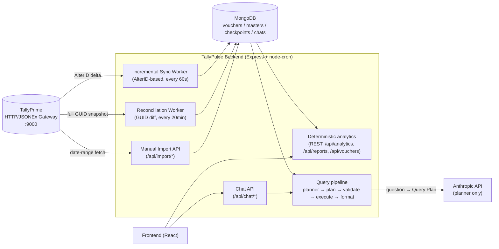
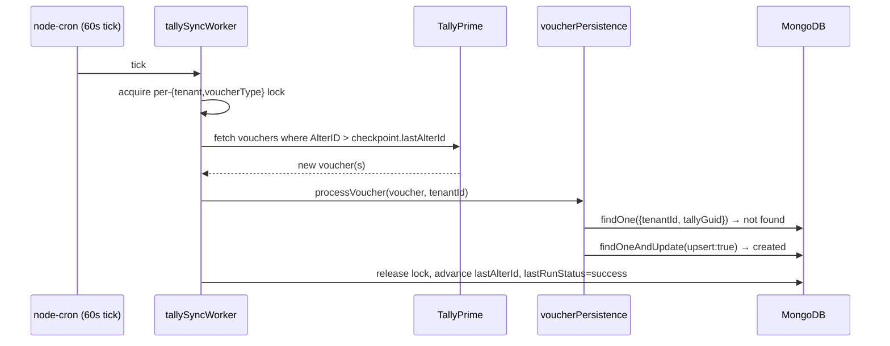
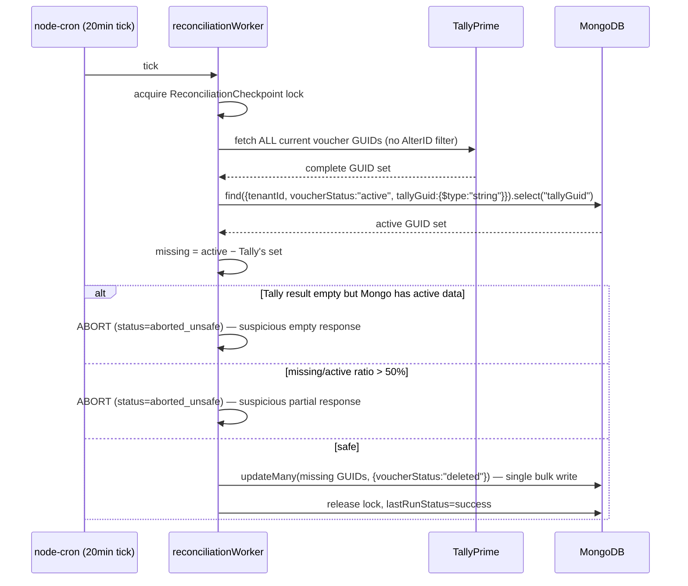

# TallyPulse — Technical Documentation

> **Status:** maintained with the code; describes the repository as it is at `HEAD`. Claims about TallyPrime's behaviour are labelled **REAL** (confirmed against a live TallyPrime instance), **SYNTHETIC** (verified only with constructed data) or **UNVERIFIED**. For a shorter, task-oriented map of the codebase read [`PROJECT_CONTEXT.md`](PROJECT_CONTEXT.md); this document is the long form.

---

## 1. Project Overview

### 1.1 Purpose and current scope

TallyPulse synchronizes accounting data out of a locally running **TallyPrime** installation into **MongoDB** and serves it through a deterministic analytics layer, dashboards, reports and an **Ask AI** chat. The central design rule: **every number shown to a user is computed by deterministic code from the user's own synced data; the language model only turns a question into a structured query.**

**Implemented and working end to end:**
- Automatic incremental sync of Sales, Purchase, Credit Note and Debit Note vouchers, plus on-demand master refreshes (stock items → stock groups, ledgers and groups).
- A separate reconciliation safety net (detects vouchers deleted in Tally, which incremental sync structurally cannot see), self-heal and checkpoint-independent recovery.
- Deterministic REST analytics, vouchers list/search, reports with CSV export, and a React frontend (dashboard, analytics, reports, sync status, Ask AI).
- Registration, JWT authentication, "Connect Tally" company onboarding (the company is detected from TallyPrime, never typed), multi-company access per account, tenant isolation everywhere.
- Ask AI: a Claude **planner** produces a validated Query Plan; a deterministic engine executes it (§11, §12).

### 1.2 Technology stack

| Layer | Technology | Notes |
|---|---|---|
| Runtime | Node.js (CommonJS) | `backend/` |
| Web framework | Express 5 | `backend/server.js` |
| Database | MongoDB via Mongoose 9 | `MONGODB_URI` |
| Scheduling | `node-cron` | drives the sync and reconciliation workers |
| Validation | `zod` | the Query Plan schema (`src/services/query/queryPlan.schema.js`) |
| AI | `@anthropic-ai/sdk` | used only by the query planner |
| Auth | `jsonwebtoken` + `bcryptjs` | §4, §7 |
| Tally integration | `axios` over TallyPrime's HTTP/JSONEx gateway | §6 |
| File upload | `multer` | disk storage in `backend/uploads/`, deleted as soon as the file has been processed or refused |
| HTTP hardening | `helmet` + `cors` | security headers and a CORS allow-list (`CORS_ORIGINS`, default: the local Vite origins) — `src/middleware/httpSecurity.js` |
| Error responses | `src/middleware/errorHandler.js` | clients only see messages the code chose; library/database error text stays in the server log |
| Frontend | React 19, Vite, Tailwind CSS 4, Recharts, react-markdown | `frontend/` — talks to the backend over REST only |
| Env config | `dotenv` | `backend/.env` (template: `backend/.env.example`) |

### 1.3 High-level architecture



---

## 2. System Architecture

| Component | Role | File(s) |
|---|---|---|
| **TallyPrime** | Source of truth for all accounting data, reached over HTTP/JSONEx on `localhost:9000` (configurable per company). | external |
| **Incremental Sync Worker** | Polls Tally for vouchers changed since the last `$AlterID` and upserts them into MongoDB, per {company, voucher type}: Sales, Purchase, Credit Note, Debit Note. | `src/services/sync/tallySyncWorker.js`, `batchWindow.js`, `voucherPersistence.js` |
| **Reconciliation Worker** | Separate, slower job: fetches *all* current voucher GUIDs from Tally and marks MongoDB-active vouchers missing from that set as `deleted`. The only mechanism that can detect real deletions. Self-heal and recovery repair data/checkpoint mismatches. | `src/services/sync/reconciliation*.js`, `selfHeal.js`, `voucherRecovery.js` |
| **Master refreshes** | On-demand reads of stock items → groups and ledger/group masters (`refresh-stock-item-master.js`, `refresh-ledger-master.js`). | `src/services/tally/stockItemMaster.js`, `ledgerMaster.js` |
| **MongoDB** | Synchronized analytical store (§5). | `src/models/*.js` |
| **Analytics (REST)** | Deterministic aggregations behind the dashboards, reports and analytics pages. Always tenant + active-voucher scoped. | `src/services/analytics/*.js`, `src/controllers/{analytics,report,voucher}Controller.js` |
| **Query pipeline (Ask AI)** | Planner → Query Plan → validation → execution → deterministic answer and presentation. | `src/services/query/*.js` (§11) |
| **Chat API** | Persists conversations per {tenant, user} and calls the query pipeline for every question. | `src/controllers/chatController.js`, `src/routes/chatRoutes.js` (§12) |
| **Frontend** | React single-page app. | `frontend/` (§17) |

---

## 3. Data Flow

### 3.1 New voucher flow (incremental sync)



### 3.2 Altered voucher flow

Same path as above, except `Model.findOne({tenantId, tallyGuid})` **finds** an existing document. `voucherPersistence.js` compares the incoming `$AlterID` against the stored `tallyAlterId`:
- incoming `> stored` → the document is updated in place (`status: "updated"`), and the AlterID is advanced.
- incoming `<= stored` → treated as a re-poll of an already-applied delta (`status: "duplicate"`), no write performed. This makes retries and out-of-order delivery safe.

### 3.3 Cancelled voucher flow

Tally reports `$IsCancelled = true` on the voucher. `tallyParser.js` extracts this into `sync.isCancelled`; if the voucher can't be fully mapped (a cancelled voucher's header is often sparse), `voucherPersistence.js`'s `handleUnmappableVoucher()` looks the document up by `tallyGuid` (or, only if no GUID is available, a disambiguated `voucherNo` — never guessed if that number is shared by more than one document) and sets `voucherStatus: "cancelled"`. **The document is never physically deleted** — this preserves the audit trail. Analytics excludes it automatically because `analyticsScope.js` defaults to `voucherStatus: "active"` only.

### 3.4 Deleted voucher + reconciliation flow

**REAL, confirmed finding:** a voucher genuinely deleted in TallyPrime does not appear in *any* Tally collection query, at *any* `$AlterID` threshold, and its `$IsDeleted` flag never becomes `true` in practice — it simply vanishes from Tally's own results. This means the incremental sync (§3.1–3.3) **structurally cannot detect a deletion**. The reconciliation worker exists specifically for this:



Reconciliation **never** touches `SyncCheckpoint`/`lastAlterId` — it has its own, entirely separate `ReconciliationCheckpoint` collection, so a reconciliation failure can never be confused with (or corrupt) the incremental sync's state.

### 3.5 Failed sync/retry flow

Both workers follow the same pattern: the Mongo checkpoint's lock is only released — and only advanced on success — inside a `finally`-equivalent path that runs regardless of outcome.

- **Incremental sync** (`tallySyncWorker.js`): if any voucher in a batch fails to process, the whole batch is marked `lastRunStatus: "failed"` and `lastAlterId` is **not** advanced — the next tick re-fetches the same delta. Vouchers that did succeed within that batch are not rolled back (the upsert is idempotent, so reprocessing them is a harmless no-op).
- **Reconciliation** (`reconciliation.js`): every step (Tally fetch, JSON parse, GUID extraction, the Mongo `find`, the Mongo `updateMany`) is wrapped so the function *never throws* — it always returns `{status: "success"|"failed"|"aborted_unsafe", ...}`. This was a real gap found and fixed during backend verification (2026-09-17): the two Mongo steps were previously unguarded, which meant a MongoDB write failure left the checkpoint locked until a 3×-interval stale-lock timeout instead of being retryable on the very next scheduled run. Both workers reclaim a lock automatically if it's held past a staleness multiple of their own interval (5× for sync, 3× for reconciliation) — a crashed process can never wedge that tenant's job forever.

---

## 4. Multi-Tenant / Company Architecture

| Concept | Meaning in this codebase |
|---|---|
| `tenantId` | A generated `mongoose.Types.ObjectId().toString()`, created once when a company is first connected ("Connect Tally", §7.3) and **reused whenever the same Tally company is connected again**. **This — not `companyGuid` — is the identity every Sale/Purchase/analytics query is scoped by.** Internal only: users never enter it and the company APIs do not return it. |
| `companyGuid` | TallyPrime's own company GUID — the authoritative company identity, but **never typed by a user**: "Connect Tally" reads it from the company currently open in TallyPrime. Used to look up the `Company` record and to resolve which Tally connection to use; a company's data-access identity is always re-derived from it via `tenantId`, never trusted directly for data access. The company display name is never used as an identity. |
| Current company model | `src/models/company.js` — one document per company: `companyName`, `sourceType` (`"tally"`), `companyGuid` (unique), `tenantId` (unique), `isActive`, optional `tallyConnection.baseUrl` (a per-company Tally endpoint override; falls back to `TALLY_URL`/`localhost:9000` when unset). |
| Authorization/isolation | `src/services/auth/companyContext.js` → `resolveAuthorizedCompany(authUser, requestedCompanyGuid)`. Re-fetches the live `Company` record and re-checks `isActive` on every call — a stale JWT claim is never trusted for data access on its own. |
| Active company context | The `activeCompanyContext` Express middleware attaches `req.companyContext = {tenantId, companyGuid, companyId, companyName}` after authorization; `liveCompanyContext` additionally re-checks the account's access against the database on every request (sync, voucher, import and rename routes). See §7. |

**Account → company flow.** An account (`User`) is created with just name, email and password and has no company. "Connect Tally" (`POST /api/auth/companies`, §7.3) then detects the company open in TallyPrime and connects it; the first one becomes the account's default (`User.companyName/companyGuId/companyId/tenantId`, all optional until then). Every company an account can use is also listed in `UserCompanyAccess` (`{userId, companyId, companyGuid, tenantId}`), and `companyContext.js` authorizes a non-default company through that join collection.

**Same company, same tenant.** `src/services/auth/companyIdentity.js` (`ensureCompanyForGuid`) makes the Tally GUID keep its tenant: connecting a company that was deactivated reactivates it, and connecting one whose `Company` record was deleted reuses the single historical tenant found in its checkpoints / access rows — so `SyncCheckpoint`s and vouchers are preserved and sync continues from the stored `lastAlterId`, not from 0. Several candidate tenants → `409` (never guessed or merged).

**Access is not implied by Tally.** Having a company open in TallyPrime proves *which* company is connected, not that the account may have it. If other live accounts own the company, connecting it returns `403 You don't have access to this company.` There is no invitation / owner-approval mechanism yet (known gap); until one exists a company belongs to the account that connected it first.

Every tenant-scoped write path (`voucherPersistence.js`) and every analytics read path (`analyticsScope.js`) requires `tenantId` as an explicit, non-optional parameter and fails closed (throws) if it's missing — there is no code path where a query can silently run without a tenant filter.

---

## 5. Database Architecture

### 5.1 Collections and key fields

| Collection (Model) | Key fields | Purpose |
|---|---|---|
| `Company` (`company.js`) | `companyName`, `sourceType`, `companyGuid` (unique), `tenantId` (unique), `isActive`, `tallyConnection.baseUrl` | One document per tenant/company. |
| `User` (`user.model.js`) | `name`, `email` (unique), `password` (bcrypt hash), `role`, `tokenVersion`, and the account's *default* company `companyName`, `companyGuId`, `companyId`, `tenantId` — all optional, empty until the first company is connected | Login identity. |
| `UserCompanyAccess` (`userCompanyAccess.model.js`) | `userId`, `companyId`, `companyGuid`, `tenantId` | Every company an account may use (§4). |
| `Sale`, `Purchase` (`sales.model.js`, `purchase.model.js`) | `tenantId`, `header{voucherNo, voucherDate, voucherType, voucherTotalAmount, narration, partyName}`, `inventory[]`, `ledgers[]`, `tallyGuid`, `tallyAlterId`, `voucherStatus` (`active`\|`cancelled`\|`deleted`) | Voucher stores — **separate collections** (voucher numbers are only unique within their own numbering series in Tally). |
| `AdjustmentNote` (`adjustmentNote.model.js`) | `tenantId`, `companyGuid`, `header{…}`, `noteType` (credit/debit), `classification` (sales_return / purchase_return / value_adjustment / unclassified), richer `inventory[]`/`ledgers[]` | Credit and Debit Notes, one normalized model; `classification` decides whether a note is a return. |
| `LedgerMaster` (`ledgerMaster.model.js`) | `tenantId`, `companyGuid`, `ledgerGuid`, `name`, `parentGroup`, `partyRole`, `accountRole`, `createdDate`, `removedAt` | Ledger masters: who is a customer/supplier, and when a party ledger was created ("new customer"). |
| `StockItemMaster` (`stockItemMaster.model.js`) | `tenantId`, `itemName`, `stockGroupName`, `tallyGuid`; optional `gst` (dated HSN/taxability/rate history per duty head and state, from `gstSchemas.js`) | Item → stock group, for product-group analytics. `gst` is stored master data only; no answer reads it. |
| `SyncCheckpoint` (`syncCheckpoint.model.js`) | `tenantId`, `companyGuid`, `voucherType`, `lastAlterId`, `lastSyncedAt`, `lastRunStatus`, `lastError`, `isRunning`, `lockedAt` | One document per {tenant, company, voucherType}; drives incremental sync. |
| `ReconciliationCheckpoint` (`reconciliationCheckpoint.model.js`) | Same lock shape, plus `lastRunStatus` (`never_run`\|`success`\|`failed`\|`aborted_unsafe`), counters and self-heal fields | Deliberately separate from `SyncCheckpoint`. |
| `TenantDataVersion` (`tenantDataVersion.model.js`) | `tenantId`, `version` | Per-tenant counter bumped by `dataVersion.tenantDataVersionPlugin` on every write to a model that feeds answers; invalidates the answer cache. |
| `Chat` (`chat.model.js`) | `tenantId`, `userId`, `title`, `messages[]` (each: `role`, `text`, `toolCalls[]`, `visualization`, `dataAsOf`, `freshness`, `warnings[]`, `queryContext`) | Chat history. Assistant messages carry the deterministic answer, its presentation model and the **structured plan** (`queryContext`) used for follow-ups — never raw Mongo documents or prompts. |
| `AiTurnUsage` (`aiTurnUsage.model.js`) | `ts`, `tenantId`, `requestId` (unique when present), `aiPath`, `plannerModel`, token counters, latencies, `ok`, `failureCategory` | One usage record per AI turn, written fire-and-forget (`AI_USAGE_PERSIST=off` disables). Counters only; no prompts, names or figures. |

### 5.2 Voucher identity: `{tenantId, tallyGuid}`

The unique identity of a voucher master is `{tenantId, tallyGuid}` — **not** `voucherNo`. This was a deliberate fix (see `migrate-voucher-identity.js`, already applied): two distinct Tally voucher masters can legitimately share the same `voucherNo`, confirmed against a live TallyPrime instance. `voucherNo` remains a plain, non-unique, indexed **display** field.

### 5.3 Indexes

| Collection | Index | Purpose |
|---|---|---|
| `Sale`, `Purchase` | `{tenantId:1, tallyGuid:1}` unique, **partial** (`tallyGuid: {$type:"string"}`) | Voucher identity. Partial because Mongoose defaults an unset `tallyGuid` to literal `null`, and a plain unique index would collide across every guid-less legacy document. |
| `Sale`, `Purchase` | `{tenantId:1, "header.voucherNo":1}` | Non-unique, display/lookup only. |
| `Sale`, `Purchase` | `{tenantId:1, voucherStatus:1, "header.voucherDate":1}` | Matches `analyticsScope.buildVoucherMatchStage()`'s filter shape exactly — confirmed via `.explain()` to serve every analytics query and the reconciliation GUID read with an index scan, not a collection scan, at 8,000+ documents. |
| `Company` | `companyGuid` unique, `tenantId` unique | one-to-one identity. |
| `User` | `email` unique | login identity. |
| `SyncCheckpoint`, `ReconciliationCheckpoint` | `{tenantId:1, companyGuid:1, voucherType:1}` unique | one checkpoint per {tenant, company, voucherType}. |
| `Chat` | `{tenantId:1, userId:1, updatedAt:-1}` | chat list ordering, scoped by both tenant and user together. |

---

## 6. TallyPrime Integration

### 6.1 Connection / configuration

TallyPrime exposes an HTTP/JSONEx gateway (its "ODBC port"; the backend speaks HTTP to it, not the ODBC protocol). Default: `http://localhost:9000`, overridable via `TALLY_URL`, or per-company via `Company.tallyConnection.baseUrl`. Whichever address is used must be `http://` or `https://`, without credentials, and not a link-local / cloud-metadata address (`src/services/odbc/tallyUrl.js`, checked when a company is saved and again where each request is built; localhost and LAN addresses are allowed — audit F-10). All requests are `axios.post(baseUrl, tdlRequestBody, {headers})` with a 30-second timeout (`src/services/odbc/odbcService.js`).

### 6.2 Required Tally-side setup

Inferred from the working request bodies (not separately documented elsewhere in the repo): TallyPrime must have its HTTP server / JSONEx export enabled on the configured port, with the relevant company loaded. Requests use `"TallyRequest": "Export"`, `svExportFormat: "jsonex"`, and ad-hoc TDL `Collection` definitions built inline per request (no `.tdl` files on disk) — Tally itself must accept these dynamically-defined collections, which was confirmed working during testing.

### 6.3 Incremental AlterID mechanism

Every voucher in Tally carries a monotonically increasing `$AlterID`, bumped on create **and** modify (confirmed live: it is genuinely filterable server-side, not merely accepted and ignored). `getSalesVouchersSinceAlterId` / `getPurchaseVouchersSinceAlterId` filter with `$AlterID > <checkpoint.lastAlterId>`, requesting `Date, VoucherTypeName, VoucherNumber, PartyLedgerName, AlterID, Guid, MasterID, IsCancelled, IsDeleted, inventoryentries.*, ledgerentries.*`. This is what makes the sync correctly pick up an edit to a months-old voucher (its `$Date` never changes, but its `$AlterID` does).

### 6.4 Lightweight reconciliation GUID query

`getAllSalesVoucherGuids` / `getAllPurchaseVoucherGuids` request **only** `Guid`, with no `$AlterID` filter at all (a deleted voucher never appears regardless of threshold, so filtering by AlterID here would defeat the query's purpose) and no inventory/ledger walk. Tally still returns its own base field set regardless — `Native Method` only *adds* requested fields, it can't narrow the response below Tally's defaults — but this is confirmed to be meaningfully lighter than the incremental fetch.

### 6.5 Known Tally limitations discovered during testing

- **REAL, confirmed:** a genuinely deleted voucher disappears from every Tally collection query entirely; `$IsDeleted` does not become `true` in practice. This is the entire reason the reconciliation worker exists (§3.4).
- **UNVERIFIED:** whether `$IsDeleted` would ever actually be observed `true` for some other deletion path/Tally configuration not yet tested — the parser still defensively handles it (marks the document `deleted`, never removes it) in case it ever does occur.
- **REAL, confirmed:** `$IsCancelled` and `$AlterID` are both real, reliably queryable, filterable fields.
- Tally's HTTP/JSONEx values frequently arrive wrapped (e.g. `{value: "...", taxtype: "GST"}` or `[{metadata:true,...}, "value"]`) rather than as plain scalars — `tallyParser.unwrapJsonExValue()` exists specifically to normalize this before any field is read.

---

## 7. API Documentation

All routes are mounted in `backend/server.js`. "Company context" below means the request carries a company-scoped JWT: `activeCompanyContext` resolves it to `req.companyContext = {tenantId, companyGuid, companyId, companyName}` from the live `Company` record; `liveCompanyContext` additionally re-checks the account's access against the database on every request. No route ever reads a tenant or company from the request body or query string.

### 7.0 Route inventory

| Method | Path | Auth | Controller |
|---|---|---|---|
| GET | `/` | none | inline in `server.js` (health check) |
| POST | `/api/auth/register` | none (rate-limited) | `authController.register` |
| POST | `/api/auth/login` | none (rate-limited: 10 failed attempts per client + e-mail and 100 per client, per 15 minutes) | `authController.login` |
| POST | `/api/auth/companies` | JWT (no company needed; rate-limited) | `authController.addCompany` ("Connect Tally") |
| GET | `/api/auth/companies` | JWT | `authController.listCompanies` |
| POST | `/api/auth/switch-company` | JWT | `authController.switchCompany` |
| PATCH | `/api/auth/company` | JWT + live company context | `authController.updateCompanyName` |
| POST | `/api/import/tally-json` | JWT + live company context (checked before the upload is stored) | `importController.importTallyJson` |
| POST | `/api/import/tally-live` | JWT + live company context | `importController.importTallyLive` |
| GET | `/api/odbc/company` | JWT (no company needed — used during onboarding) | `odbcController.testTallyConnection` |
| GET | `/api/odbc/sales` | JWT + live company context; must be the company Tally has selected | `odbcController.getSales` |
| GET | `/api/sync/status` | JWT + live company context | `syncStatusController.getSyncStatus` |
| POST | `/api/sync/recovery` | JWT + live company context | `syncRecoveryController.runVoucherRecovery` (dry run by default) |
| GET | `/api/vouchers/sales`, `/api/vouchers/purchases` | JWT + live company context | `voucherController` (paginated, searchable lists) |
| GET | `/api/analytics/sales/{summary,comparison,top-products,growing-products,declining-products,top-customers,trend,customer-counts,stock-groups}` | JWT + company context | `analyticsController` |
| GET | `/api/analytics/purchases/{summary,comparison,top-suppliers,trend}` | JWT + company context | `analyticsController` |
| GET | `/api/reports/{products,customers}` | JWT + company context | `reportController` |
| GET | `/api/reports/{sales,purchases,products,customers}/export` | JWT + company context | `reportController` (CSV stream) |
| GET | `/api/chat/` | JWT + company context | `chatController.listChats` |
| POST | `/api/chat/message`, `/api/chat/:chatId/message` | JWT + company context | `chatController.sendChatMessage` |
| GET | `/api/chat/:chatId` | JWT + company context | `chatController.getChat` |
| PATCH | `/api/chat/:chatId` | JWT + company context | `chatController.renameChat` |
| DELETE | `/api/chat/:chatId` | JWT + company context | `chatController.deleteChat` |

> **Security note (audit F-03 / F-06):** `/api/odbc/*` requires a signed-in user; `/sales` additionally requires a live, authorized company and answers only when that company is the one Tally has selected (otherwise `403`). Company access for the sync, voucher, import and rename routes is re-checked against the live account on every request. See `TallyPulse-Security-Audit.md`, Section 0.

**Request ids and logs (audit F-19).** Every response carries an `X-Request-Id` header (a client-sent id is reused only if it is short and plain); a server-error body also repeats it as `requestId`, and the matching server-log line starts with `request=<id>`. Failed logins and rate-limit hits are logged with the id and the client address — never the e-mail or password. **Git:** real `.env` files (any `.env.*`) are ignored at the repository root, in `backend/` and in `frontend/`; `backend/.env.example` is the committed template.

**Sessions and error responses (audit F-08 / F-12).** Every authenticated request loads the account once: a deleted user, or a token whose session version (`tv` claim) differs from `User.tokenVersion`, gets `401`. Raising `tokenVersion` signs an account out everywhere. Error bodies are always `{ success:false, message }` with a message chosen by the code — malformed JSON is `400 The request body is not valid JSON.`, an oversized body or upload is `413`, and anything unexpected is `500 Something went wrong on the server. Please try again.` (details in the server log only).

### 7.1 `GET /`

Health check. No auth.

**Response 200:**
```json
{ "success": true, "message": "TallyPulse Backend Running", "version": "1.0.0" }
```

### 7.2 `POST /api/auth/register`

Creates an account. No auth (this *is* the sign-up path). The password must be at least 8 characters and at most 72 bytes (bcrypt only uses the first 72 bytes); `name`, `email` and `password` must be text. **No company, GUID or tenant is asked for** — the company is connected afterwards (§7.3b).

**Body (JSON):**
```json
{
  "name": "Jane Doe",
  "email": "jane@example.com",
  "password": "plaintext-password"
}
```

**Response 201:**
```json
{ "success": true, "message": "User registered" }
```

**Errors:**
| Status | Condition |
|---|---|
| 400 | any of `name/email/password` missing |
| 400 | the address may already have an account — the reply is deliberately the generic "We could not create this account. If you already have one, sign in instead." (audit F-16) |
| 500 | unexpected server/DB error |

### 7.3 `POST /api/auth/login`

**Body:**
```json
{ "email": "jane@example.com", "password": "plaintext-password" }
```

**Response 200:**
```json
{ "success": true, "token": "<JWT, 7 day expiry>", "hasCompany": false }
```

`hasCompany` is `false` for an account that has not connected a company yet. Its token identifies the account only (payload `{ id, role }`): it is accepted by the `/api/auth/*` connect/list/switch routes and refused (401) by every route that needs company data. Once a company is connected, the token is scoped to the account's default company: payload `{ id, role, companyGuId, tenantId }` — internal claims the frontend never displays.

**Errors:** 401 `Invalid credentials` (unknown email or wrong password — indistinguishable on purpose), 500.

### 7.3b `POST /api/auth/companies` — Connect Tally

Connects the company **currently open in TallyPrime** to the signed-in account. **Requires** `Authorization: Bearer <JWT>` (a company-less token from login is enough). The user types nothing about the company: the backend asks Tally which company is open and uses that company's name and GUID (the GUID stays internal).

**Flow:** Register → Login → Connect Tally → the backend detects the current company.

**Which company, when several are open.** TallyPrime can have several companies open at once, and its company list does not say which one is selected. The backend therefore never uses list order or a display name: with one open company it uses that one; with several it runs one light voucher-type master query and picks the open company whose GUID owns the returned masters (Tally answers for the *selected* company, and every master GUID is `<companyGuid>-<id>`). If exactly one company matches, that is the selected company; if none or more than one match, detection is ambiguous and the request returns `409`. The detected company is then run through the normal authorization rules below (a company owned by other accounts is still `403`) - there is never a fallback to a different open company.

**Body (JSON):** empty for the account's **first** company.
```json
{}
```
For any **further** company the account's password is required again:
```json
{ "password": "plaintext-password" }
```
(A legacy client may still send `companyGuId`; it is only an assertion and must equal the company Tally reports, otherwise 400.)

**Response 201** (new connection) / **200** (this company was already connected — "reconnected"):
```json
{
  "success": true,
  "message": "Company connected.",
  "token": "<JWT scoped to the connected company>",
  "data": { "companyGuid": "<opaque key used only by switch-company>", "companyName": "We Four", "created": true, "reactivated": false }
}
```
`tenantId` is never returned. `created`/`reactivated` describe what happened; a company that already existed (deactivated, or its record deleted) keeps its tenant, checkpoints and data.

**Errors:**
| Status | Condition |
|---|---|
| 400 | no company is open: `Please open your company in TallyPrime and try again.` |
| 400 | a client-sent `companyGuId` does not match the open company |
| 401 | invalid session; or, for a second company, missing/incorrect `password` |
| 403 | `You don't have access to this company.` — other accounts own it (no invitation mechanism yet) |
| 409 | several companies are open and the selected one cannot be identified (`More than one company is open in TallyPrime. Keep only the company you want to connect open and try again.`) — an ambiguity response, not an access denial; or several historical tenants match (`Company connection is ambiguous; contact administrator.`) |
| 503 | TallyPrime is unreachable |

Companion routes: `GET /api/auth/companies` lists `[{ companyGuid, companyName, isActive, isDefault }]`; `POST /api/auth/switch-company` `{ "companyGuId": "<companyGuid from the list>" }` returns a token scoped to another company the account already has access to (no password, 403 otherwise); `PATCH /api/auth/company` `{ "companyName" }` renames the active company.

### 7.4 `POST /api/import/tally-json`

Manual file-upload import. **Requires** `Authorization: Bearer <JWT>`. `multipart/form-data`, field name `file`, `.json` only, 10 MB limit (`multer`, `src/middleware/upload.js`).

**Headers:** `Authorization: Bearer <token>`, `Content-Type: multipart/form-data`

**Response 200 (single voucher):**
```json
{ "success": true, "message": "Tally sales imported successfully", "data": { "created": true, "updated": false, "duplicate": false, "saleId": "<mongo _id>" } }
```

**Response 200 (multiple vouchers):**
```json
{
  "success": true,
  "message": "Tally sales import summary",
  "data": { "total": 12, "created": 10, "updated": 1, "duplicates": 1, "skipped": 0, "failed": 0, "results": [ { "voucherNo": "SA/1", "status": "created", "saleId": "<id>" } ] }
}
```

**Errors:**
| Status | Condition |
|---|---|
| 400 | no file uploaded / not a `.json` file / invalid JSON / no voucher data found / company not found or inactive |
| 401 | missing `companyGuId` in JWT |
| 500 | unexpected error |

### 7.5 `POST /api/import/tally-live`

Fetches Sales vouchers directly from the live TallyPrime HTTP gateway (date-range based, **not** the AlterID-incremental path) and runs them through the same import pipeline. **Requires JWT.**

**Query params:** `fromDate`, `toDate` — both optional, `YYYY-MM-DD`; default to "today" for both if omitted. The range may span **at most 92 days** (a wider query can hang TallyPrime); a longer range, a reversed range (`toDate` before `fromDate`) or a repeated parameter is refused with `400` before Tally is contacted. Import longer periods in several requests.

```
POST /api/import/tally-live?fromDate=2026-09-01&toDate=2026-09-17
Authorization: Bearer <token>
```

**Response shape:** identical to §7.4.

**Errors:** 503 if `"Tally is unavailable: ..."` (connection failure), 400 for invalid or too-wide date ranges / no voucher data in range / bad company context, 401 if JWT lacks `companyGuId`, 500 otherwise (with a generic message — the details are in the server log).

> There is **no equivalent live-import endpoint for Purchase vouchers** — Purchase data only enters MongoDB via the automatic incremental sync worker (§8), not through any manual HTTP endpoint.

### 7.6 `GET /api/odbc/company`

Tests connectivity to TallyPrime and returns the company name TDL report. **JWT required** (any signed-in account; see the note in §7.0).

**Response 200:**
```json
{
  "success": true,
  "message": "Tally API connection successful",
  "data": { /* raw Tally JSONEx company list, for diagnostics */ },
  "detected": { "state": "ok", "companyName": "WE FOUR" }
}
```

`detected` is the authoritative answer to "which company is TallyPulse talking to?": the only open company or, with several open, the **selected** one (same rule as Connect Tally, §7.3b). `state` is `ok`, `ambiguous` (several open, selection not identifiable; includes a `message`), `no_company` or `unreachable`. It carries the company name only. Clients (the frontend's Test Connection) must use `detected` and never read the first entry of `data`.

**Errors:** 500 with `{success:false, message:"<axios/Tally error>"}` if Tally is unreachable.

### 7.7 `GET /api/odbc/sales`

Fetches raw Sales vouchers for "today" (no date-range params are wired to this route) directly from Tally and returns the **raw, unparsed** Tally JSONEx payload — this does **not** write to MongoDB and does **not** go through the parser/mapper pipeline. **JWT + a connected company required, and the company open (selected) in Tally must be the caller's own — otherwise `403`.**

**Response 200:** `{ "success": true, "data": { /* raw Tally response */ } }`
**Errors:** 500 on Tally connection failure.


### 7.8 Analytics, vouchers, reports and sync status (summary)

These read-only endpoints serve the dashboards, analytics pages and reports. They take `period` (`current_month`, `previous_month`, `custom` with `from`/`to`) or the period kinds of `periodEngine` where noted, resolve relative periods from the tenant's reference date (`dateRanges.resolveRequestPeriod` / `resolveRequestComparison`, `periodEngine`), and return the trust envelope (`{state, data, freshness, message}`, §10). CSV exports stream the exact rows of the report they export. `GET /api/sync/status` reports each voucher type's checkpoint; `POST /api/sync/recovery` re-reads vouchers missing from MongoDB (a dry run unless confirmed).

### 7.9 `POST /api/chat/message` and `POST /api/chat/:chatId/message`

Ask a question. Omit `:chatId` to start a new chat; include it to continue one that belongs to the same tenant and user.

**Body:** `{ "message": "Top 5 customers by sales this month" }`

**Response 200:**
```json
{
  "success": true,
  "chatId": "<chat id>",
  "data": {
    "answer": "…deterministic text (Markdown-ish lines)…",
    "insights": [],
    "visualization": { "v": 1, "kind": "ranking", "…": "presentation model, or null" },
    "details": { "toolCalls": [{ "toolName": "query_engine", "state": "valid_data" }], "queryEngine": { "route": "planner", "status": "answered", "claudeCalls": 1, "cache": "miss" } },
    "dataAsOf": "ISO date or null",
    "freshness": { "state": "fresh", "message": "…" },
    "warnings": []
  }
}
```

Every turn ends with an honest answer in this shape: a figure computed by the engine, a clarification question, a refusal ("not available", "not synced for that period"), or a fixed failure message (planner unavailable, query too slow). There is no other chat path. The stored plan for follow-ups travels on the saved message, not in this response.

**Errors:** `400` empty or non-string `message`, `404` `chatId` not found or not owned, `500` unexpected failure (generic body). A client that disconnects (the Stop button) ends the turn: nothing is saved and nothing is written to the closed connection.

### 7.10 `GET /api/chat/`, `GET /api/chat/:chatId`, `PATCH /api/chat/:chatId`, `DELETE /api/chat/:chatId`

- `GET /` — the caller's chats for the active company (`_id`, `title`, timestamps), newest first.
- `GET /:chatId` — one chat with its messages. `404` if not found or not owned.
- `PATCH /:chatId` — rename: `{ "title": "…" }`, trimmed, 1–100 characters, no control characters; only the title changes and the list order is unaffected.
- `DELETE /:chatId` — delete one chat. Every lookup filters by both `tenantId` and `userId`; another user's or company's chat id is a `404`.

---

## 8. Sync Architecture

| Aspect | Sales | Purchase |
|---|---|---|
| Model | `Sale` | `Purchase` (separate collection) |
| Fetch fn | `getSalesVouchersSinceAlterId` | `getPurchaseVouchersSinceAlterId` |
| Mapper | `mapTallySale` | `mapTallyPurchase` |
| Manual import endpoint | `/api/import/tally-json`, `/api/import/tally-live` | **none** |
| Checkpoint | `SyncCheckpoint{voucherType:"Sales"}` | `SyncCheckpoint{voucherType:"Purchase"}` — fully independent document |

- **Credit and Debit Notes** sync through their own pipeline (`adjustmentNotePersistence.js`, the `AdjustmentNote` model, one `SyncCheckpoint` each for `voucherType` "Credit Note" and "Debit Note") so the proven Sales/Purchase path is untouched. Reconciliation and recovery do not cover them yet (§16).
- **Idempotency:** `voucherPersistence.js`'s `createVoucherPersistence()` is the single shared upsert core for both. Identity is `{tenantId, tallyGuid}`; if a matching document exists and its stored `tallyAlterId >= incoming`, the write is skipped (`status:"duplicate"`). Re-running an already-applied batch is provably a no-op (tested — see §13).
- **AlterID handling:** the checkpoint's `lastAlterId` only ever advances inside `releaseLock()`, and only when the batch's status is explicitly `"success"`. A batch with any failures leaves `lastAlterId` untouched so the same delta is retried next tick.
- **Retry behavior:** both workers are designed to never throw out of their top-level per-{tenant, module} function — every outcome (success, partial failure, Tally error, Mongo error) returns a result object and always releases its own lock.
- **Worker scheduling:** `node-cron`, started from `server.js` only after `connectDB()` resolves. Sync interval: `TALLY_SYNC_INTERVAL_SECONDS` (default 60s). Reconciliation interval: `RECONCILIATION_INTERVAL_MINUTES` (default 20min).
- **Locking:** both use a Mongo-document mutex (`isRunning` + `lockedAt`) per {tenant, company, voucherType}, with stale-lock reclaim at 5× the sync interval / 3× the reconciliation interval.
- **Reconciliation fail-closed safety:** see §3.4 and §9.
- **Multi-company:** `Company.find({isActive:true})` is iterated by both workers on every tick — every active company, and every voucher type within it, is synced independently; one company/type's failure never blocks another (verified with a synthetic dedicated-tenant test, §13).

---

## 9. Data Integrity & Safety

| Concern | How it's handled | Verified |
|---|---|---|
| Voucher GUID identity | `{tenantId, tallyGuid}` unique partial index; `voucherNo` demoted to a display field | Migration applied (`migrate-voucher-identity.js`); regression-tested |
| Duplicate prevention | AlterID comparison in `voucherPersistence.js` before every write | **REAL + SYNTHETIC** tested |
| Altered voucher updates | Same upsert path; `findOneAndUpdate` with `runValidators`/`setDefaultsOnInsert` | **SYNTHETIC** tested |
| Cancellation/deletion (via sync) | `voucherStatus` soft-state, document never removed; ambiguity guard refuses to guess when a GUID-less tombstone's `voucherNo` matches more than one document | **SYNTHETIC** tested |
| Reconciliation safety | Fail-closed on: Tally connection error, malformed JSON, empty-Tally-but-active-Mongo, >50% delete ratio (`RECONCILIATION_MAX_DELETE_RATIO`), and — as of the 2026-09-17 fix — a MongoDB read/write failure after a successful Tally fetch | **REAL** (two actual deleted vouchers detected live) + **SYNTHETIC** (all abort paths) |
| Checkpoint safety | `lastAlterId`/reconciliation status only ever written inside the lock-release path; a thrown error before that point is now impossible for reconciliation (fixed) and was already guarded for incremental sync | Tested with an induced Mongo failure |
| Tenant isolation | `analyticsScope.buildVoucherMatchStage()` throws on a missing/invalid `tenantId`; every persistence filter includes `tenantId` explicitly | Tested with two tenants sharing an identical `tallyGuid` — no cross-tenant effect |
| Stale data / freshness | `freshness.js` derives `fresh`/`stale`/`sync_failed`/`never_synced` from `SyncCheckpoint`, threshold `ANALYTICS_FRESHNESS_THRESHOLD_MINUTES` (default 15) | code-reviewed, exercised in §13's 18-check suite |
| Analytics active-voucher filtering | `DEFAULT_STATUSES = ["active"]` in `analyticsScope.js` — cancelled/deleted vouchers are excluded from every analytics query unless a caller explicitly opts into a wider status set (no current caller does) | Confirmed live: analytics order counts exactly matched active-only counts after two real reconciled deletions |

---

## 10. Analytics Engine

Plain MongoDB aggregations — **no Claude involvement anywhere** in `src/services/analytics/` — and every `$match` stage is built through `analyticsScope.buildVoucherMatchStage()`, which requires a `tenantId`, defaults to active vouchers only and turns each period bound into the stored (UTC-midnight) form of its calendar day.

| Module | Role |
|---|---|
| `salesAnalytics.js`, `purchaseAnalytics.js` | Summaries, comparisons, top products/customers/suppliers, growing/declining products, trends, customer counts, customer sales. Back the REST analytics endpoints and are the independent oracles the query engine is checked against (`verify-query-parity.js`). |
| `stockGroupAnalytics.js` | Deterministic Top-10 stock-group sales (item → group via `StockItemMaster`). |
| `reportAnalytics.js` | Product/customer reports and CSV export rows. |
| `periodEngine.js` | The single source of period kinds (current/previous week, month, quarter, FY, YTD, rolling windows, custom, same-period-last-year…) and their like-for-like / full-previous comparison windows. |
| `dateRanges.js` | Calendar helpers (month-end-safe shifts), the REST request periods (`resolveRequestPeriod`, `resolveRequestComparison`) and the one conversion between the two date conventions: voucher/ledger dates are stored as UTC midnight of the Tally date while period boundaries are local calendar days, so `storedDayStart` / `storedDayEnd` / `calendarDayOfStored` / `parseCalendarDay` compare them by calendar day. The server's time zone therefore never moves a voucher across a period edge. |
| `referenceDate.js` | The tenant's reference date (today, end of the local day) and its synced coverage window, both as calendar days; one read per chat turn. |
| `coverage.js` | Classifies a requested period against the synced window: covered / partly outside (caveat) / outside (refusal — missing data is never shown as zero). |
| `freshness.js` | `fresh` / `stale` / `sync_failed` / `never_synced` from `SyncCheckpoint` (threshold `ANALYTICS_FRESHNESS_THRESHOLD_MINUTES`, default 15). |
| `trustEnvelope.js` | Wraps every REST analytics result as `{state, data, freshness, message}`. |

```json
{
  "state": "valid_data | zero_result | stale_data | sync_failed | no_usable_data | analytics_error",
  "data": { "…": "the numbers; always includes hasData" },
  "freshness": { "state": "fresh | stale | sync_failed | never_synced", "dataAsOf": "ISO date or null", "minutesSinceLastSync": 13, "lastRunStatus": "success | failed | never_run", "lastError": null, "message": "…" },
  "message": "human-readable state explanation, or null when state=valid_data"
}
```

Growth percentages are `null` (never infinity or zero) when the previous value is 0; products new in a period carry `isNew: true`. Category analytics beyond stock groups does not exist: the stored voucher items carry no category field and nothing is invented.

---

## 11. AI Architecture: the query pipeline

There is **one** AI path. Claude is called once per question, as a *planner*; everything else is deterministic.

```
question (+ the previous turn's structured plan, for follow-ups)
  → safety gate (unsafe/empty/oversized text is refused before any call)
  → freshness gate (nothing is planned for a company that never synced)
  → planner:  ONE forced tool call `submit_query_plan` → a Query Plan, or a decline
  → parseQueryPlan (strict zod schema) → validateQueryPlan (semantic catalog, tenant reference date)
  → planner guards: year stated?  revenue basis?  new-customer comparison?  month-comparison rule
  → tenant-scoped entity resolution (every customer/supplier/product/group name re-verified against the tenant's own data)
  → freshness + coverage gates (no data is never shown as zero)
  → answer cache (keyed by plan + reference date + TenantDataVersion)
  → compile (safe, tenant-scoped aggregation pipeline) → execute (bounded time and size)
  → deterministic answer text + presentation model (KPI / ranking / trend / comparison / table / empty)
```

| Module (`src/services/query/`) | Role |
|---|---|
| `queryChat.js` | The only entry point (`tryAnswerWithQueryEngine`): runs the pipeline above and always ends in an honest answer. |
| `planner.js` | The Claude call and the server-side guards. System prompt (`buildCatalogDigest`: metric meanings, the validator rules the schema cannot express, the unsupported list - all read from the catalog) and tool schema are generated from the catalog and marked cacheable; the request is the question (plus the previous plan as JSON) — never chat history, tenant data or the date. Bounded: attempt timeout, deadline, no repair call on the chat path. Anthropic-shaped client seam (`claudeClient(request, {signal})`). |
| `queryPlan.schema.js` | The Query Plan v1 contract: entity (sales, purchase, sales_return, purchase_return), mode (aggregate/list), metrics, groupBy, filters, compare, having, sort, limit. Strict: tenant/company fields, Mongo operators and expressions are structurally impossible. |
| `semanticCatalog.js` | What each metric, dimension, period and entity *means*; the single source for validator, compiler, planner prompt and tests. |
| `validator.js` | Semantic validation and resolution of relative periods with the tenant reference date. |
| `entityResolver.js` | Per-tenant name lists; an exact normalized match wins, or a unique leading word; an outage is reported as "unavailable", never as "not found". |
| `compile.js`, `execute.js` | The plan becomes an aggregation pipeline that starts with the tenant + active `$match` (`assertPipelineSafe`); executor limits time and result size. |
| `answerCache.js`, `dataVersion.js` | Cache invalidated by any write to a model that feeds answers. |
| `followUp.js` | The previous turn's plan, stored on the assistant message and strictly re-parsed before use. |
| `answerFormatter.js`, `presentation.js` | Deterministic text and the structured presentation model; no figure is computed by Claude or by the frontend. |
| `turnTelemetry.js`, `usageStore.js` | One allow-listed event per turn (codes only) and one `AiTurnUsage` record. |

**What Claude can never do here (structurally):** reach MongoDB, choose a tenant, write a pipeline, invent a name that is not in the tenant's data, or put a figure in an answer. It can only return a plan that survives the schema, the validator and the guards, or a decline.

**Failure behaviour:** planner unreachable or unusable → a fixed "planner unavailable" message (no figure, no second Claude path); query too slow/large or any unexpected error → a fixed failure message; period outside the synced window → a missing-data refusal; unsupported or ambiguous question → the planner's decline or clarification.

**Evaluation:** `backend/verify-nlu-eval.js` scores the planner against `backend/eval/nlu-corpus.json` (synthetic names, expected Query Plans). Its default mode is a free self-check; `--live --limit=N` makes one planner call per question. `backend/eval-nlu-models.js` compares models: it runs the same corpus rows through the unchanged planner with the Claude baseline and any OpenRouter models (`OPENROUTER_EVAL_MODELS`, `OPENROUTER_API_KEY`), scores every answer with the same semantic comparator (a plan that executes but means the wrong thing is *wrong*), and reports exact / acceptable / wrong / invalid / failure rates, latency percentiles, tokens and per-category breakdowns (language, follow-up, comparison, ranking, period, grouping, entity, capability-gap, clarification). It uses bounded concurrency (`NLU_EVAL_CONCURRENCY`) and a response cache keyed by the planner prompt/schema fingerprint, writes git-ignored reports to `backend/eval/results/`, and is evaluation-only: the OpenRouter client lives under `backend/eval/` and no production file imports it. OpenRouter use is **free-only**: each model id must be an exact `:free` id whose every price field in the live catalogue is 0 (otherwise it is recorded as unavailable and not called, never replaced), requests name that one model, forbid provider fallbacks and cap the price at 0, routers (`openrouter/*`) are refused, and a response reporting a cost halts the model. OpenRouter limits free models to 20 requests/minute and, for an account that never purchased credits, 50 requests/day, so `--sample=N` evaluates N evenly spaced rows, requests are paced (`--rpm`), a model refused three times in a row is halted, and cached answers let later days continue where a run stopped.

---

## 12. Chat Architecture

- **Model:** `Chat` (§5.1), scoped by `{tenantId, userId}` together.
- **Routes:** `src/routes/chatRoutes.js` — every route passes `auth` (JWT) then `activeCompanyContext` before the controller runs.
- **Turn:** `sendChatMessage` loads (or creates in memory) the chat, appends the user message, calls the query pipeline with `{tenantId, companyGuid}`, the previous structured plan and the abort signal, appends the assistant message (answer, presentation, freshness, warnings, stored plan) and only then saves — a failed turn never leaves an orphan chat.
- **Stop:** the browser's `AbortController` closes the HTTP response; the controller turns that into an abort signal that stops the planner call, skips saving and records `clientAborted` / HTTP 499 in telemetry. Tokens the provider already processed may still be billed.
- **Telemetry:** one `tallypulse.ai.turn` log line per turn (allow-listed codes, no free text) and one `AiTurnUsage` record, both carrying the request id returned as `X-Request-Id`.
- **Frontend rendering:** the answer text is rendered as sanitised Markdown; the `visualization` model drives KPI cards, ranking/trend/comparison charts and exact-value tables.

---

## 13. Testing

There is no test framework: every suite is a plain `node verify-*.js` script in `backend/` (and `verify-*.mjs` in `frontend/`) that prints a pass/fail line per check and exits non-zero on failure. Suites that need MongoDB use **synthetic tenants** they create and remove themselves; suites with a "REAL DATA" section compare against the real WE FOUR / Nirmal tenants read-only and print `SKIPPED` where those do not exist.

| Area | Suites |
|---|---|
| Query pipeline | `verify-query-dsl`, `verify-query-engine`, `verify-query-cache`, `verify-query-parity`, `verify-query-planner`, `verify-planner-digest`, `verify-query-chat`, `verify-semantic-foundation`, `verify-entity-resolver`, `verify-presentation` |
| Chat, cost, telemetry | `verify-chat-management`, `verify-cost-forensic`, `verify-ai-telemetry`, `verify-ai-usage-persist` |
| Planner evaluation | `verify-nlu-eval` (free self-check; `--live` is billed), `verify-openrouter-eval` (offline tests of the multi-model evaluation, local stub server), `eval-nlu-models.js` (manual; the Claude baseline is billed, OpenRouter models are free-only), `verify-planner-live-eval` (manual, real tenant, billed) |
| Semantics and capabilities | `verify-comparison-period-capability`, `verify-growth-comparison-capability`, `verify-period-engine`, `verify-month-boundary-dates`, `verify-timezone-boundaries` (six server zones), `verify-return-*`, `verify-product-return-analytics`, `verify-ledger-master`, `verify-adjustment-note` |
| Analytics and data layer | `verify-analytics-scope`, `verify-stock-item-master`, `verify-stock-group-analytics`, `verify-tally-parser-voucher-total`, `verify-sales-mapper`, `verify-migrate-voucher-total-amount` |
| Sync and recovery | `verify-sync-batching`, `verify-voucher-recovery`, `verify-self-heal`, `verify-reconciliation-history`, `verify-reconciliation-perf-and-failure` |
| Identity and security | `verify-security-audit` (executable audit probes), `verify-company-identity`, `verify-company-ownership`, `verify-multi-company` |
| Needs live TallyPrime | `verify-voucher-type-classification`, `verify-voucher-lifecycle`, `verify-sync-worker-guard`, `verify-reconciliation` |
| Needs a running backend on :5000 | `verify-company-guid-match`, `verify-dashboard-real-data`, `verify-reports`, `verify-voucher-pagination` |
| Frontend (from `frontend/`) | `verify-chat-api.mjs`, `verify-chat-rendering.mjs`, `verify-chat-presentation.mjs`, `verify-dashboard-report-link.mjs`; `verify-chat-timeout.cjs` (about 45 s, run manually) |

**CI** (`.github/workflows/ci.yml`, on pull requests and pushes to `main`): backend install + syntax check + `npm audit`, frontend lint + build + verification scripts, and the self-contained backend suites above against a throwaway MongoDB service. The live-Tally, running-backend and billed-Claude suites are excluded and run manually.

---

## 14. Deployment / Environment

### 14.1 Environment variables

`backend/.env.example` is the committed template, with every variable below and its default. A real `.env` is never committed.

| Variable | Used in | Default if unset |
|---|---|---|
| `PORT` | `server.js` | `5000` |
| `MONGODB_URI` | `src/config/db.js` | none — required, process exits on connection failure |
| `JWT_SECRET` | `authController.js`, `middleware/auth.js` | none — required |
| `ANTHROPIC_API_KEY` | `planner.js` | none — without it every question gets the "planner unavailable" answer |
| `ANTHROPIC_PLANNER_MODEL`, `ANTHROPIC_MODEL` | `planner.js`, `usageStore.js` | a built-in default model |
| `AI_USAGE_PERSIST` | `usageStore.js` | persisting; `off` disables |
| `TALLY_URL` | `odbcService.js` | `http://localhost:9000` |
| `TALLY_SYNC_INTERVAL_SECONDS`, `TALLY_SYNC_BATCH_SIZE` | `tallySyncWorker.js` | `60`, workers' own default |
| `RECONCILIATION_INTERVAL_MINUTES`, `RECONCILIATION_MAX_DELETE_RATIO` | `reconciliationWorker.js`, `reconciliation.js` | `20`, `0.5` |
| `SELF_HEAL_ENABLED`, `SELF_HEAL_COOLDOWN_MINUTES`, `SELF_HEAL_MAX_BATCHES`, `SELF_HEAL_BATCH_SIZE`, `SELF_HEAL_MAX_AUTO_RECOVER` | `selfHeal.js` | `true`, `360`, `3`, unset, `20000` |
| `VOUCHER_TYPE_CLASSIFICATION_CACHE_TTL_MINUTES` | `voucherTypeClassifier.js` | `360` |
| `CORS_ORIGINS` | `httpSecurity.js` | the local Vite dev origins |
| `ANALYTICS_FRESHNESS_THRESHOLD_MINUTES` | `freshness.js` | `15` |

### 14.2 Ports / network

- Backend HTTP server: `PORT` (default 5000). Frontend dev server: 5173.
- MongoDB: reached via `MONGODB_URI`.
- TallyPrime: `localhost:9000` by default — an on-prem/LAN assumption. The backend process must reach the machine running TallyPrime directly; there is no tunnel or relay in this codebase.
- Anthropic API: outbound HTTPS from the backend, from the planner only.

### 14.3 Worker requirements

The sync, reconciliation and self-heal workers start from `server.js` in the same Node process as the HTTP server, after `connectDB()` resolves. There is no separate worker deployment.

---

## 15. Current Project Status

| Area | Status |
|---|---|
| Sales / Purchase / Credit Note / Debit Note incremental sync | **DONE** |
| Voucher identity (`tenantId`+`tallyGuid`) | **DONE** |
| Reconciliation, self-heal, recovery (Sales/Purchase) | **DONE**; reconciliation verified live and synthetically up to 8,000 vouchers |
| Reconciliation/recovery for Credit/Debit Notes | **NOT IMPLEMENTED** (incremental sync only) |
| Master refreshes (stock items, ledgers) | **DONE**, on demand (no scheduled job) |
| REST analytics, vouchers, reports (CSV) | **DONE** |
| Ask AI (planner + deterministic engine, follow-ups, Stop, rename, delete) | **DONE** |
| Return analytics (sales/purchase returns, product-level returns) | **DONE** (engine); planner prompt coverage of the return entities is evaluated separately (`verify-nlu-eval.js`) |
| Auth, Connect Tally, multi-company access, tenant isolation | **DONE** |
| Invitation / owner approval for multi-user access to one company | **NOT IMPLEMENTED** |
| Manual Purchase import endpoint | **NOT IMPLEMENTED** (Purchase enters via the incremental worker) |
| Frontend | **DONE** (React) |
| Automated tests | scripts + CI (§13); no test framework |

---

## 16. Known Limitations / Risks

1. **Reconciliation's empty-result guard cannot distinguish "bad Tally response" from "this tenant genuinely has zero vouchers"**: both abort as `aborted_unsafe`. Safe, but a legitimately empty new tenant would look stuck.
2. **Reconciliation is untested at real production scale** (tens of thousands of vouchers); verified synthetically to 8,000.
3. **No poison-voucher quarantine:** one unmappable voucher blocks the checkpoint.
4. **Credit/Debit Note recovery and reconciliation do not exist yet**; a manually deleted note strands like a manually deleted Sale would.
5. **No manual Purchase import endpoint**: if the sync worker is down for long, there is no manual fallback for Purchase data.
6. **No invitation system:** a company belongs to the account that connected it first.
7. **Stock-item and ledger masters refresh on demand only.**
8. **On-prem/LAN Tally connectivity assumption** (§14.2): a cloud deployment needs a connectivity story that does not exist here.
9. **The planner is not cached** and costs one Claude call per question; the entity resolver cold-loads a tenant's name lists after a data refresh.
10. **Stop cannot undo provider work already done**: tokens processed before the abort may still be billed; if the server finished and saved before the disconnect arrived, the turn appears when the chat is reopened.
11. **REST dashboards anchor to the latest voucher** and their `vs_previous_month` cards keep the same-days comparison, while Ask AI uses today's date and "this month vs last month" means the month to date against the complete previous month (see `PROJECT_CONTEXT.md` §H).

---

## 17. Frontend

`frontend/` is a React 19 + Vite single-page app (Tailwind CSS 4, Recharts, react-router). Pages: Dashboard, Sales / Purchase / Customers / Products analytics, Reports (with CSV export), Sync Data (checkpoint status and recovery), Ask AI, Settings, and the auth pages (register, login, Connect Tally). It talks to the backend over REST with the company-scoped JWT; it never computes a business number — Ask AI figures come from the answer text and the presentation model the backend produced. `frontend/src/api/` holds the API layer; `frontend/src/components/chat/` renders answers.

---

## 18. Developer Guide

### 18.1 Project structure

```
TallyPulse/
├── backend/
│   ├── server.js                       # Express app entry point
│   ├── .env.example                    # configuration template (real .env is git-ignored)
│   ├── src/
│   │   ├── config/db.js
│   │   ├── controllers/                # auth, import, odbc, chat, analytics, report, voucher, sync*
│   │   ├── middleware/                 # auth, httpSecurity, rateLimit, requestId, errorHandler, upload
│   │   ├── models/                     # §5.1
│   │   ├── routes/
│   │   └── services/
│   │       ├── analytics/              # §10
│   │       ├── auth/                   # companyContext, companyIdentity, tallyCompanyGuard
│   │       ├── import/                 # tallySalesImport, tallyPurchaseImport
│   │       ├── mapper/ parser/         # Tally voucher -> documents
│   │       ├── odbc/                   # Tally HTTP/JSONEx client (+ URL safety)
│   │       ├── query/                  # §11 the query pipeline
│   │       ├── sync/                   # workers, reconciliation, self-heal, recovery, persistence
│   │       └── tally/                  # masters, voucher-type classifier, ownership guard
│   ├── eval/nlu-corpus.json            # planner evaluation corpus (synthetic names)
│   ├── verify-*.js                     # verification suites (§13)
│   └── *.js                            # operator scripts (master refreshes, migrations, index tools)
├── frontend/                           # React app + verify-*.mjs
├── docs/                               # this file, PROJECT_CONTEXT.md, SEMANTIC_FOUNDATION.md
├── TallyPulse-Security-Audit.md        # security audit, fix log and runnable probes' register
├── .github/workflows/ci.yml
└── CLAUDE.md                           # working rules for AI-assisted development
```

### 18.2 Install and configure

```bash
cd backend && npm install
cp .env.example .env     # then fill in MONGODB_URI, JWT_SECRET and (for Ask AI) ANTHROPIC_API_KEY
cd ../frontend && npm install
```

### 18.3 Run

```bash
cd backend && node server.js        # API + both workers (nodemon: npx nodemon server.js)
cd frontend && npm run dev          # http://localhost:5173
```

### 18.4 Verify

```bash
cd backend && node verify-query-planner.js     # any single suite
cd frontend && npm run lint && npm run build && node verify-chat-rendering.mjs
```

Each backend suite connects to the configured MongoDB, creates and removes its own synthetic data, and prints `X passed, Y failed`. Point `MONGODB_URI` at a throwaway database when running the sync/reconciliation/security suites — CI does.

### 18.5 Development notes

- Never assume TallyPrime or the backend process are still running from a previous session.
- Tally is queried one request at a time, narrow ranges, bounded timeouts; the gateway hangs under wide or concurrent queries.
- No real tenant data in fixtures: use synthetic names and GUIDs.
- Commits and pushes are made only on explicit instruction (`CLAUDE.md`).

---

## 19. API Testing Examples

### 19.1 Register an account

```bash
curl -X POST http://localhost:5000/api/auth/register \
  -H "Content-Type: application/json" \
  -d '{
    "name": "Jane Doe",
    "email": "jane@example.com",
    "password": "ChangeMe123!"
  }'
```

### 19.2 Log in and capture a token

```bash
curl -X POST http://localhost:5000/api/auth/login \
  -H "Content-Type: application/json" \
  -d '{ "email": "jane@example.com", "password": "ChangeMe123!" }'
```

```bash
TOKEN=$(curl -s -X POST http://localhost:5000/api/auth/login \
  -H "Content-Type: application/json" \
  -d '{"email":"jane@example.com","password":"ChangeMe123!"}' \
  | node -e "process.stdin.on('data',d=>console.log(JSON.parse(d).token))")
```

### 19.2b Connect Tally (open your company in TallyPrime first)

```bash
curl -X POST http://localhost:5000/api/auth/companies \
  -H "Authorization: Bearer $TOKEN" \
  -H "Content-Type: application/json" \
  -d '{}'
```

Response (201): `{ "success": true, "message": "Company connected.", "token": "<company-scoped JWT>", "data": { "companyName": "We Four", "created": true, "reactivated": false, ... } }`. Use the returned `token` from here on. A second company additionally needs `{"password": "ChangeMe123!"}` in the body.

### 19.3 Upload a Tally JSON export

```bash
curl -X POST http://localhost:5000/api/import/tally-json \
  -H "Authorization: Bearer $TOKEN" \
  -F "file=@your-tally-sales-export.json"
```

### 19.4 Trigger a live Tally import for a date range

```bash
curl -X POST "http://localhost:5000/api/import/tally-live?fromDate=2026-09-01&toDate=2026-09-17" \
  -H "Authorization: Bearer $TOKEN"
```

### 19.5 Test raw Tally connectivity (needs a signed-in user)

```bash
curl -H "Authorization: Bearer <token>" http://localhost:5000/api/odbc/company
curl -H "Authorization: Bearer <company-scoped-token>" http://localhost:5000/api/odbc/sales
```

### 19.6 Chat — list, send, fetch, delete

```bash
# List chats
curl http://localhost:5000/api/chat/ -H "Authorization: Bearer $TOKEN"

# Send a message (starts a new chat); needs ANTHROPIC_API_KEY, otherwise the answer says the planner is unavailable
curl -X POST http://localhost:5000/api/chat/message \
  -H "Authorization: Bearer $TOKEN" \
  -H "Content-Type: application/json" \
  -d '{"message":"How did sales grow this month compared to last month?"}'

# Fetch a specific chat
curl http://localhost:5000/api/chat/<chatId> -H "Authorization: Bearer $TOKEN"

# Rename a chat
curl -X PATCH http://localhost:5000/api/chat/<chatId> \
  -H "Authorization: Bearer $TOKEN" -H "Content-Type: application/json" \
  -d '{"title":"Q3 sales review"}'

# Delete a chat
curl -X DELETE http://localhost:5000/api/chat/<chatId> -H "Authorization: Bearer $TOKEN"
```

### 19.7 Deterministic analytics (no AI involved)

```bash
curl "http://localhost:5000/api/analytics/sales/summary?period=current_month" \
  -H "Authorization: Bearer $TOKEN"
curl "http://localhost:5000/api/analytics/sales/top-customers?period=custom&from=2026-09-01&to=2026-09-30" \
  -H "Authorization: Bearer $TOKEN"
```

Both return the trust envelope (§10).

---

## 20. Architecture Decisions

| Decision | Rationale |
|---|---|
| **Tally is the source of truth; MongoDB is a synchronized analytical store, not a second system of record.** | Every write path derives from a Tally voucher (or, for the manual endpoints, a Tally-shaped JSON export); nothing is invented in Mongo that didn't originate in Tally. |
| **Voucher identity is `{tenantId, tallyGuid}`, not `voucherNo`.** | Confirmed live that two distinct Tally voucher masters can share a voucher number; keying identity on `tallyGuid` is the only correct choice, applied identically to both Sale and Purchase. |
| **Incremental AlterID sync + a separate reconciliation safety-net, rather than one mechanism trying to do both.** | AlterID-based polling is cheap and correct for creates/edits but structurally cannot see deletions (confirmed live); rather than compromise the proven incremental path, deletion detection was built as its own independent job with its own checkpoint, cadence, and fail-closed guards. |
| **Shared-database, multi-tenant architecture via `tenantId`, not per-tenant databases.** | One MongoDB deployment serves every company; isolation is enforced entirely in application code (`analyticsScope`, `voucherPersistence`, `companyContext`) rather than at the infrastructure level — a deliberate simplicity trade-off, with `tenantId` treated as a mandatory, fail-closed parameter everywhere. |
| **Deterministic analytics before AI.** | Every number the product shows is computed by a plain MongoDB aggregation, wrapped in an explicit trust/freshness envelope, by code, never by a model. Claude's only role is turning a question into a structured Query Plan, never computation — enforced structurally (the plan schema cannot express a tenant, a Mongo operator or a figure; the engine compiles every pipeline itself), not just by prompt instruction. |
| **Smallest-safe-change / parallel-implementation over shared abstraction.** | Reconciliation deliberately mirrors (rather than shares code with) the incremental sync worker's lock pattern, and uses its own checkpoint collection, so a bug in the newer mechanism can never corrupt the proven one. |
| **Fail-closed as the default posture for anything touching tenant data or bulk mutations.** | Both `analyticsScope` (missing tenantId) and `reconciliation.js` (connection errors, malformed responses, suspicious empty results, high delete ratios, and now Mongo failures) refuse to act rather than guess, even at the cost of occasionally requiring manual review. |
