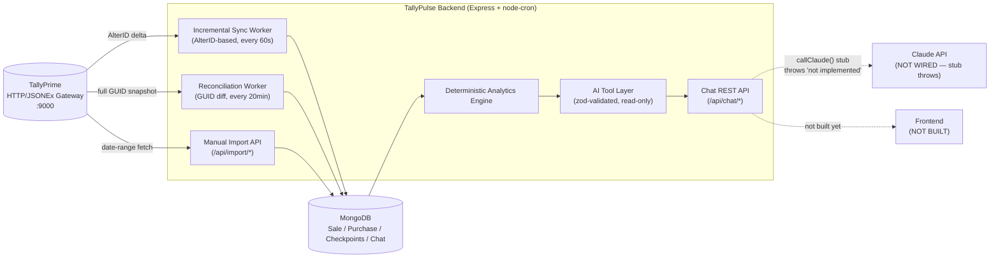
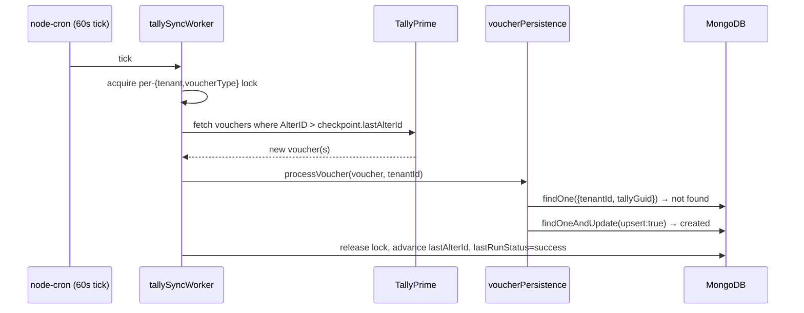
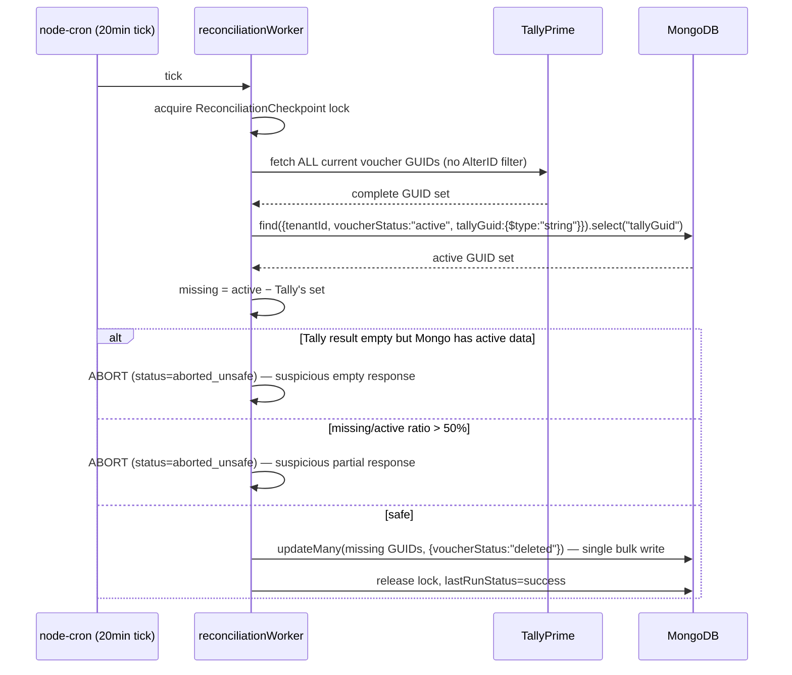

# TallyPulse — Backend Technical Documentation

> **Status:** living document, generated from a direct inspection of the repository at `D:\TallyPulse` on 2026-09-17. Every claim below is either verified against the current source code (marked **IMPLEMENTED**), confirmed against a live TallyPrime instance during testing (marked **REAL**), verified only through synthetic/mocked tests (marked **SYNTHETIC**), or explicitly called out as **NOT IMPLEMENTED** / **UNVERIFIED** / **PLANNED**. Nothing here documents a feature that does not exist in the code.

---

## 1. Project Overview

### 1.1 Purpose and current scope

TallyPulse synchronizes accounting data (Sales and Purchase vouchers) out of a locally-running **TallyPrime** installation into **MongoDB**, and exposes that data through a deterministic analytics layer. The long-term goal is a BI/AI business assistant where Claude answers natural-language questions using only pre-computed, verified analytics — Claude is designed to be an *explanation layer*, never the source of numbers.

**Currently implemented and working end-to-end:**
- Automatic, incremental Sales + Purchase sync from TallyPrime into MongoDB.
- A separate reconciliation safety-net that detects vouchers deleted in Tally (which the incremental sync structurally cannot see).
- Deterministic analytics (sales/purchase summaries, comparisons, top products/customers, growth/decline).
- User/company registration, JWT authentication, and a single-company-per-user authorization model.
- A chat data model, chat REST routes, and a fully-built Claude tool-calling pipeline — **with the actual network call to the Claude API stubbed out** (see §11).

**Not yet built:** a frontend of any kind, live Claude API integration, category-level analytics, true multi-company-per-user access.

### 1.2 Technology stack

| Layer | Technology | Notes |
|---|---|---|
| Runtime | Node.js (CommonJS) | `"type": "commonjs"` in `package.json` |
| Web framework | Express 5 | `backend/server.js` |
| Database | MongoDB via Mongoose 9 | Atlas-hosted per `MONGODB_URI` |
| Scheduling | `node-cron` | drives both sync workers |
| Validation | `zod` | AI tool argument schemas only |
| Auth | `jsonwebtoken` + `bcryptjs` | see §4 |
| Tally integration | `axios` over Tally's HTTP/JSONEx gateway | see §6 |
| File upload | `multer` | disk storage, `backend/uploads/` |
| Env config | `dotenv` | `backend/.env` |

**Declared but unused dependencies** (present in `package.json`, no active `require()` anywhere in `src/` or the route/server files — verified by repository-wide search): `odbc`, `joi`, `winston`, `bcrypt` (the app uses `bcryptjs`, a different package, for actual hashing). These are leftovers from an earlier design (a real ODBC driver connection to Tally was tried and abandoned — see the commented-out block at the top of `src/services/odbc/odbcService.js` — in favor of the HTTP/JSONEx integration actually in use today).

### 1.3 High-level architecture



---

## 2. System Architecture

| Component | Role | File(s) | Status |
|---|---|---|---|
| **TallyPrime** | Source of truth for all accounting data. Reached over HTTP/JSONEx on `localhost:9000` (configurable). | external | Running locally during development |
| **Incremental Sync Worker** | Polls Tally for vouchers changed since the last `$AlterID`, upserts them into MongoDB. Runs per {company, voucher type}. | `src/services/sync/tallySyncWorker.js` | **IMPLEMENTED** |
| **Reconciliation Worker** | Separate, slower job. Fetches *all* current voucher GUIDs from Tally and marks any MongoDB-active voucher missing from that set as `deleted`. The only mechanism that can detect real deletions. | `src/services/sync/reconciliationWorker.js`, `src/services/sync/reconciliation.js` | **IMPLEMENTED**, real-tested |
| **MongoDB** | Synchronized analytical store — `Sale`, `Purchase`, `SyncCheckpoint`, `ReconciliationCheckpoint`, `Company`, `User`, `Chat`. | `src/models/*.js` | **IMPLEMENTED** |
| **Analytics Engine** | Deterministic MongoDB aggregations, always tenant + active-voucher scoped. | `src/services/analytics/*.js` | **IMPLEMENTED** (except category analytics) |
| **AI / Claude layer** | Tool schemas + router + orchestration loop are built and tested against a mock Claude client. The actual `callClaude()` network call is a stub that throws. | `src/services/ai/*.js` | **PARTIALLY IMPLEMENTED** — see §11 |
| **Future Frontend** | No frontend code exists anywhere in this repository. | — | **NOT IMPLEMENTED** |

---

## 3. Data Flow

### 3.1 New voucher flow (incremental sync)



### 3.2 Altered voucher flow

Same path as above, except `Model.findOne({tenantId, tallyGuid})` **finds** an existing document. `voucherPersistence.js` compares the incoming `$AlterID` against the stored `tallyAlterId`:
- incoming `> stored` → the document is updated in place (`status: "updated"`), and the AlterID is advanced.
- incoming `<= stored` → treated as a re-poll of an already-applied delta (`status: "duplicate"`), no write performed. This makes retries and out-of-order delivery safe.

### 3.3 Cancelled voucher flow

Tally reports `$IsCancelled = true` on the voucher. `tallyParser.js` extracts this into `sync.isCancelled`; if the voucher can't be fully mapped (a cancelled voucher's header is often sparse), `voucherPersistence.js`'s `handleUnmappableVoucher()` looks the document up by `tallyGuid` (or, only if no GUID is available, a disambiguated `voucherNo` — never guessed if that number is shared by more than one document) and sets `voucherStatus: "cancelled"`. **The document is never physically deleted** — this preserves the audit trail. Analytics excludes it automatically because `analyticsScope.js` defaults to `voucherStatus: "active"` only.

### 3.4 Deleted voucher + reconciliation flow

**REAL, confirmed finding:** a voucher genuinely deleted in TallyPrime does not appear in *any* Tally collection query, at *any* `$AlterID` threshold, and its `$IsDeleted` flag never becomes `true` in practice — it simply vanishes from Tally's own results. This means the incremental sync (§3.1–3.3) **structurally cannot detect a deletion**. The reconciliation worker exists specifically for this:



Reconciliation **never** touches `SyncCheckpoint`/`lastAlterId` — it has its own, entirely separate `ReconciliationCheckpoint` collection, so a reconciliation failure can never be confused with (or corrupt) the incremental sync's state.

### 3.5 Failed sync/retry flow

Both workers follow the same pattern: the Mongo checkpoint's lock is only released — and only advanced on success — inside a `finally`-equivalent path that runs regardless of outcome.

- **Incremental sync** (`tallySyncWorker.js`): if any voucher in a batch fails to process, the whole batch is marked `lastRunStatus: "failed"` and `lastAlterId` is **not** advanced — the next tick re-fetches the same delta. Vouchers that did succeed within that batch are not rolled back (the upsert is idempotent, so reprocessing them is a harmless no-op).
- **Reconciliation** (`reconciliation.js`): every step (Tally fetch, JSON parse, GUID extraction, the Mongo `find`, the Mongo `updateMany`) is wrapped so the function *never throws* — it always returns `{status: "success"|"failed"|"aborted_unsafe", ...}`. This was a real gap found and fixed during backend verification (2026-09-17): the two Mongo steps were previously unguarded, which meant a MongoDB write failure left the checkpoint locked until a 3×-interval stale-lock timeout instead of being retryable on the very next scheduled run. Both workers reclaim a lock automatically if it's held past a staleness multiple of their own interval (5× for sync, 3× for reconciliation) — a crashed process can never wedge that tenant's job forever.

---

## 4. Multi-Tenant / Company Architecture

| Concept | Meaning in this codebase |
|---|---|
| `tenantId` | A generated `mongoose.Types.ObjectId().toString()`, created once when a company is first connected ("Connect Tally", §7.3) and **reused whenever the same Tally company is connected again**. **This — not `companyGuid` — is the identity every Sale/Purchase/analytics query is scoped by.** Internal only: users never enter it and the company APIs do not return it. |
| `companyGuid` | TallyPrime's own company GUID — the authoritative company identity, but **never typed by a user**: "Connect Tally" reads it from the company currently open in TallyPrime. Used to look up the `Company` record and to resolve which Tally connection to use; a company's data-access identity is always re-derived from it via `tenantId`, never trusted directly for data access. The company display name is never used as an identity. |
| Current company model | `src/models/company.js` — one document per company: `companyName`, `sourceType` (`"tally"`), `companyGuid` (unique), `tenantId` (unique), `isActive`, optional `tallyConnection.baseUrl` (a per-company Tally endpoint override; falls back to `TALLY_URL`/`localhost:9000` when unset). |
| Authorization/isolation | `src/services/auth/companyContext.js` → `resolveAuthorizedCompany(authUser, requestedCompanyGuid)`. Re-fetches the live `Company` record and re-checks `isActive` on every call — a stale JWT claim is never trusted for data access on its own. |
| Active company context | The `activeCompanyContext` Express middleware attaches `req.companyContext = {tenantId, companyGuid, companyId, companyName}` after authorization. Currently used only by the chat routes (`src/routes/chatRoutes.js`); the import routes instead resolve tenant context directly from the JWT's `companyGuId` inside `tallySalesImport.resolveTenantContext()`. |

**Account → company flow.** An account (`User`) is created with just name, email and password and has no company. "Connect Tally" (`POST /api/auth/companies`, §7.3) then detects the company open in TallyPrime and connects it; the first one becomes the account's default (`User.companyName/companyGuId/companyId/tenantId`, all optional until then). Every company an account can use is also listed in `UserCompanyAccess` (`{userId, companyId, companyGuid, tenantId}`), and `companyContext.js` authorizes a non-default company through that join collection.

**Same company, same tenant.** `src/services/auth/companyIdentity.js` (`ensureCompanyForGuid`) makes the Tally GUID keep its tenant: connecting a company that was deactivated reactivates it, and connecting one whose `Company` record was deleted reuses the single historical tenant found in its checkpoints / access rows — so `SyncCheckpoint`s and vouchers are preserved and sync continues from the stored `lastAlterId`, not from 0. Several candidate tenants → `409` (never guessed or merged).

**Access is not implied by Tally.** Having a company open in TallyPrime proves *which* company is connected, not that the account may have it. If other live accounts own the company, connecting it returns `403 You don't have access to this company.` There is no invitation / owner-approval mechanism yet (known gap); until one exists a company belongs to the account that connected it first.

Every tenant-scoped write path (`voucherPersistence.js`) and every analytics read path (`analyticsScope.js`) requires `tenantId` as an explicit, non-optional parameter and fails closed (throws) if it's missing — there is no code path where a query can silently run without a tenant filter.

---

## 5. Database Architecture

### 5.1 Collections and key fields

| Collection (Model) | Key fields | Purpose |
|---|---|---|
| `Company` (`company.js`) | `companyName`, `sourceType`, `companyGuid` (unique), `tenantId` (unique), `isActive`, `tallyConnection.baseUrl` | One document per tenant/company. |
| `User` (`user.model.js`) | `name`, `email` (unique), `password` (bcrypt hash), `role` (default `"user"`), and the account's *default* company `companyName`, `companyGuId`, `companyId` (ref `Company`), `tenantId` — all optional, empty until the first company is connected | Login identity (email + password). Companies are attached with "Connect Tally" (see §4). |
| `Sale` (`sales.model.js`) | `tenantId`, `header{voucherNo, voucherDate, voucherType, voucherTotalAmount, narration, partyName}`, `inventory[]`, `ledgers[]`, `tallyGuid`, `tallyAlterId`, `voucherStatus` (`active`\|`cancelled`\|`deleted`) | Sales voucher store. |
| `Purchase` (`purchase.model.js`) | Identical shape to `Sale` | Purchase voucher store — a **separate collection**, not shared with `Sale` (voucher numbers are only unique within their own voucher-type numbering series in Tally). |
| `SyncCheckpoint` (`syncCheckpoint.model.js`) | `tenantId`, `companyGuid`, `voucherType`, `lastAlterId`, `lastSyncedAt`, `lastRunStatus` (`never_run`\|`success`\|`failed`), `lastError`, `isRunning`, `lockedAt` | One document per {tenant, company, voucherType}; drives incremental sync. |
| `ReconciliationCheckpoint` (`reconciliationCheckpoint.model.js`) | Same lock shape as above, plus `lastRunStatus` (`never_run`\|`success`\|`failed`\|`aborted_unsafe`), `lastTallyGuidCount`, `lastMongoActiveCount`, `lastMarkedDeletedCount` | Deliberately separate from `SyncCheckpoint`. |
| `Chat` (`chat.model.js`) | `tenantId`, `userId` (ref `User`), `title`, `messages[]` (each: `role`, `text`, `toolCalls[]{toolName, state}`, `visualization`, `dataAsOf`, `warnings[]`) | Chat history — stores **only** the assistant's structured answer and minimal tool-call metadata, not raw analytics payloads or Mongo documents. |

### 5.2 Voucher identity: `{tenantId, tallyGuid}`

The unique identity of a voucher master is `{tenantId, tallyGuid}` — **not** `voucherNo`. This was a deliberate fix (see `migrate-voucher-identity.js`, already applied): two distinct Tally voucher masters can legitimately share the same `voucherNo`, confirmed against a live TallyPrime instance. `voucherNo` remains a plain, non-unique, indexed **display** field.

### 5.3 Indexes

| Collection | Index | Purpose |
|---|---|---|
| `Sale`, `Purchase` | `{tenantId:1, tallyGuid:1}` unique, **partial** (`tallyGuid: {$type:"string"}`) | Voucher identity. Partial because Mongoose defaults an unset `tallyGuid` to literal `null`, and a plain unique index would collide across every guid-less legacy document. |
| `Sale`, `Purchase` | `{tenantId:1, "header.voucherNo":1}` | Non-unique, display/lookup only. |
| `Sale`, `Purchase` | `{tenantId:1, voucherStatus:1, "header.voucherDate":1}` | Matches `analyticsScope.buildVoucherMatchStage()`'s filter shape exactly — confirmed via `.explain()` to serve every analytics query and the reconciliation GUID read with an index scan, not a collection scan, at 8,000+ documents. |
| `Company` | `companyGuid` unique, `tenantId` unique | one-to-one identity. |
| `User` | `email` unique | login identity. |
| `SyncCheckpoint`, `ReconciliationCheckpoint` | `{tenantId:1, companyGuid:1, voucherType:1}` unique | one checkpoint per {tenant, company, voucherType}. |
| `Chat` | `{tenantId:1, userId:1, updatedAt:-1}` | chat list ordering, scoped by both tenant and user together. |

---

## 6. TallyPrime Integration

### 6.1 Connection / configuration

TallyPrime exposes an HTTP/JSONEx gateway (its "ODBC port," here used for HTTP, not the actual ODBC protocol — see §1.2 on the abandoned `odbc` package). Default: `http://localhost:9000`, overridable via `TALLY_URL`, or per-company via `Company.tallyConnection.baseUrl`. All requests are `axios.post(baseUrl, tdlRequestBody, {headers})` with a 30-second timeout (`src/services/odbc/odbcService.js`).

### 6.2 Required Tally-side setup

Inferred from the working request bodies (not separately documented elsewhere in the repo): TallyPrime must have its HTTP server / JSONEx export enabled on the configured port, with the relevant company loaded. Requests use `"TallyRequest": "Export"`, `svExportFormat: "jsonex"`, and ad-hoc TDL `Collection` definitions built inline per request (no `.tdl` files on disk) — Tally itself must accept these dynamically-defined collections, which was confirmed working during testing.

### 6.3 Incremental AlterID mechanism

Every voucher in Tally carries a monotonically increasing `$AlterID`, bumped on create **and** modify (confirmed live: it is genuinely filterable server-side, not merely accepted and ignored). `getSalesVouchersSinceAlterId` / `getPurchaseVouchersSinceAlterId` filter with `$AlterID > <checkpoint.lastAlterId>`, requesting `Date, VoucherTypeName, VoucherNumber, PartyLedgerName, AlterID, Guid, MasterID, IsCancelled, IsDeleted, inventoryentries.*, ledgerentries.*`. This is what makes the sync correctly pick up an edit to a months-old voucher (its `$Date` never changes, but its `$AlterID` does).

### 6.4 Lightweight reconciliation GUID query

`getAllSalesVoucherGuids` / `getAllPurchaseVoucherGuids` request **only** `Guid`, with no `$AlterID` filter at all (a deleted voucher never appears regardless of threshold, so filtering by AlterID here would defeat the query's purpose) and no inventory/ledger walk. Tally still returns its own base field set regardless — `Native Method` only *adds* requested fields, it can't narrow the response below Tally's defaults — but this is confirmed to be meaningfully lighter than the incremental fetch.

### 6.5 Known Tally limitations discovered during testing

- **REAL, confirmed:** a genuinely deleted voucher disappears from every Tally collection query entirely; `$IsDeleted` does not become `true` in practice. This is the entire reason the reconciliation worker exists (§3.4).
- **UNVERIFIED:** whether `$IsDeleted` would ever actually be observed `true` for some other deletion path/Tally configuration not yet tested — the parser still defensively handles it (marks the document `deleted`, never removes it) in case it ever does occur.
- **REAL, confirmed:** `$IsCancelled` and `$AlterID` are both real, reliably queryable, filterable fields.
- Tally's HTTP/JSONEx values frequently arrive wrapped (e.g. `{value: "...", taxtype: "GST"}` or `[{metadata:true,...}, "value"]`) rather than as plain scalars — `tallyParser.unwrapJsonExValue()` exists specifically to normalize this before any field is read.

---

## 7. API Documentation

All routes are mounted in `server.js`. There are exactly **11 routes** in the whole application (verified by a full grep of every `router.get/post/put/delete` call) — no others exist.

### 7.0 Route inventory

| Method | Path | Auth | Controller |
|---|---|---|---|
| GET | `/` | none | inline in `server.js` (health check) |
| POST | `/api/auth/register` | none | `authController.register` |
| POST | `/api/auth/login` | none | `authController.login` |
| POST | `/api/auth/companies` | **JWT required** (no company needed) | `authController.addCompany` ("Connect Tally") |
| GET | `/api/auth/companies` | **JWT required** | `authController.listCompanies` |
| POST | `/api/auth/switch-company` | **JWT required** | `authController.switchCompany` |
| PATCH | `/api/auth/company` | **JWT + a connected company** | `authController.updateCompanyName` |
| POST | `/api/import/tally-json` | **JWT required** | `importController.importTallyJson` |
| POST | `/api/import/tally-live` | **JWT required** | `importController.importTallyLive` |
| GET | `/api/odbc/company` | **none** (see warning below) | `odbcController.testTallyConnection` |
| GET | `/api/odbc/sales` | **none** (see warning below) | `odbcController.getSales` |
| GET | `/api/chat/` | **JWT + activeCompanyContext** | `chatController.listChats` |
| POST | `/api/chat/message` | **JWT + activeCompanyContext** | `chatController.sendChatMessage` |
| POST | `/api/chat/:chatId/message` | **JWT + activeCompanyContext** | `chatController.sendChatMessage` |
| GET | `/api/chat/:chatId` | **JWT + activeCompanyContext** | `chatController.getChat` |
| DELETE | `/api/chat/:chatId` | **JWT + activeCompanyContext** | `chatController.deleteChat` |

> ⚠️ **Security note (verified in code, not a guess):** `src/routes/odbcRoutes.js` mounts `/company` and `/sales` with **no `auth` middleware at all** — the commented-out earlier version of this file did include `auth`, but the active code does not. Both endpoints proxy directly to TallyPrime and require no authentication today. This should be treated as a known gap (see §16), not fixed here per the "don't modify app code unless necessary for documentation accuracy" instruction for this task.

### 7.1 `GET /`

Health check. No auth.

**Response 200:**
```json
{ "success": true, "message": "TallyPulse Backend Running", "version": "1.0.0" }
```

### 7.2 `POST /api/auth/register`

Creates an account. No auth (this *is* the sign-up path). **No company, GUID or tenant is asked for** — the company is connected afterwards (§7.3b).

**Body (JSON):**
```json
{
  "name": "Jane Doe",
  "email": "jane@example.com",
  "password": "plaintext-password"
}
```

**Response 201:**
```json
{ "success": true, "message": "User registered" }
```

**Errors:**
| Status | Condition |
|---|---|
| 400 | any of `name/email/password` missing |
| 400 | `email` already registered |
| 500 | unexpected server/DB error |

### 7.3 `POST /api/auth/login`

**Body:**
```json
{ "email": "jane@example.com", "password": "plaintext-password" }
```

**Response 200:**
```json
{ "success": true, "token": "<JWT, 7 day expiry>", "hasCompany": false }
```

`hasCompany` is `false` for an account that has not connected a company yet. Its token identifies the account only (payload `{ id, role }`): it is accepted by the `/api/auth/*` connect/list/switch routes and refused (401) by every route that needs company data. Once a company is connected, the token is scoped to the account's default company: payload `{ id, role, companyGuId, tenantId }` — internal claims the frontend never displays.

**Errors:** 401 `Invalid credentials` (unknown email or wrong password — indistinguishable on purpose), 500.

### 7.3b `POST /api/auth/companies` — Connect Tally

Connects the company **currently open in TallyPrime** to the signed-in account. **Requires** `Authorization: Bearer <JWT>` (a company-less token from login is enough). The user types nothing about the company: the backend asks Tally which company is open and uses that company's name and GUID (the GUID stays internal).

**Flow:** Register → Login → Connect Tally → the backend detects the current company.

**Which company, when several are open.** TallyPrime can have several companies open at once, and its company list does not say which one is selected. The backend therefore never uses list order or a display name: with one open company it uses that one; with several it runs one light voucher-type master query and picks the open company whose GUID owns the returned masters (Tally answers for the *selected* company, and every master GUID is `<companyGuid>-<id>`). If exactly one company matches, that is the selected company; if none or more than one match, detection is ambiguous and the request returns `409`. The detected company is then run through the normal authorization rules below (a company owned by other accounts is still `403`) - there is never a fallback to a different open company.

**Body (JSON):** empty for the account's **first** company.
```json
{}
```
For any **further** company the account's password is required again:
```json
{ "password": "plaintext-password" }
```
(A legacy client may still send `companyGuId`; it is only an assertion and must equal the company Tally reports, otherwise 400.)

**Response 201** (new connection) / **200** (this company was already connected — "reconnected"):
```json
{
  "success": true,
  "message": "Company connected.",
  "token": "<JWT scoped to the connected company>",
  "data": { "companyGuid": "<opaque key used only by switch-company>", "companyName": "We Four", "created": true, "reactivated": false }
}
```
`tenantId` is never returned. `created`/`reactivated` describe what happened; a company that already existed (deactivated, or its record deleted) keeps its tenant, checkpoints and data.

**Errors:**
| Status | Condition |
|---|---|
| 400 | no company is open: `Please open your company in TallyPrime and try again.` |
| 400 | a client-sent `companyGuId` does not match the open company |
| 401 | invalid session; or, for a second company, missing/incorrect `password` |
| 403 | `You don't have access to this company.` — other accounts own it (no invitation mechanism yet) |
| 409 | several companies are open and the selected one cannot be identified (`More than one company is open in TallyPrime. Keep only the company you want to connect open and try again.`) — an ambiguity response, not an access denial; or several historical tenants match (`Company connection is ambiguous; contact administrator.`) |
| 503 | TallyPrime is unreachable |

Companion routes: `GET /api/auth/companies` lists `[{ companyGuid, companyName, isActive, isDefault }]`; `POST /api/auth/switch-company` `{ "companyGuId": "<companyGuid from the list>" }` returns a token scoped to another company the account already has access to (no password, 403 otherwise); `PATCH /api/auth/company` `{ "companyName" }` renames the active company.

### 7.4 `POST /api/import/tally-json`

Manual file-upload import. **Requires** `Authorization: Bearer <JWT>`. `multipart/form-data`, field name `file`, `.json` only, 10 MB limit (`multer`, `src/middleware/upload.js`).

**Headers:** `Authorization: Bearer <token>`, `Content-Type: multipart/form-data`

**Response 200 (single voucher):**
```json
{ "success": true, "message": "Tally sales imported successfully", "data": { "created": true, "updated": false, "duplicate": false, "saleId": "<mongo _id>" } }
```

**Response 200 (multiple vouchers):**
```json
{
  "success": true,
  "message": "Tally sales import summary",
  "data": { "total": 12, "created": 10, "updated": 1, "duplicates": 1, "skipped": 0, "failed": 0, "results": [ { "voucherNo": "SA/1", "status": "created", "saleId": "<id>" } ] }
}
```

**Errors:**
| Status | Condition |
|---|---|
| 400 | no file uploaded / not a `.json` file / invalid JSON / no voucher data found / company not found or inactive |
| 401 | missing `companyGuId` in JWT |
| 500 | unexpected error |

### 7.5 `POST /api/import/tally-live`

Fetches Sales vouchers directly from the live TallyPrime HTTP gateway (date-range based, **not** the AlterID-incremental path) and runs them through the same import pipeline. **Requires JWT.**

**Query params:** `fromDate`, `toDate` — both optional, `YYYY-MM-DD`; default to "today" for both if omitted.

```
POST /api/import/tally-live?fromDate=2026-09-01&toDate=2026-09-17
Authorization: Bearer <token>
```

**Response shape:** identical to §7.4.

**Errors:** 503 if `"Tally is unavailable: ..."` (connection failure), 400 for invalid dates / no voucher data in range / bad company context, 401 if JWT lacks `companyGuId`, 500 otherwise.

> There is **no equivalent live-import endpoint for Purchase vouchers** — Purchase data only enters MongoDB via the automatic incremental sync worker (§8.2), not through any manual HTTP endpoint.

### 7.6 `GET /api/odbc/company`

Tests connectivity to TallyPrime and returns the company name TDL report. **No auth required** (see the warning in §7.0).

**Response 200:**
```json
{
  "success": true,
  "message": "Tally API connection successful",
  "data": { /* raw Tally JSONEx company list, for diagnostics */ },
  "detected": { "state": "ok", "companyName": "WE FOUR" }
}
```

`detected` is the authoritative answer to "which company is TallyPulse talking to?": the only open company or, with several open, the **selected** one (same rule as Connect Tally, §7.3b). `state` is `ok`, `ambiguous` (several open, selection not identifiable; includes a `message`), `no_company` or `unreachable`. It carries the company name only. Clients (the frontend's Test Connection) must use `detected` and never read the first entry of `data`.

**Errors:** 500 with `{success:false, message:"<axios/Tally error>"}` if Tally is unreachable.

### 7.7 `GET /api/odbc/sales`

Fetches raw Sales vouchers for "today" (no date-range params are wired to this route) directly from Tally and returns the **raw, unparsed** Tally JSONEx payload — this does **not** write to MongoDB and does **not** go through the parser/mapper pipeline. **No auth required.**

**Response 200:** `{ "success": true, "data": { /* raw Tally response */ } }`
**Errors:** 500 on Tally connection failure.

### 7.8 `GET /api/chat/`

List the authenticated user's own chats for their active company. **Requires JWT + resolved company context.**

**Response 200:**
```json
{ "success": true, "data": [ { "_id": "...", "title": "How were sales last month?", "createdAt": "...", "updatedAt": "..." } ] }
```

### 7.9 `POST /api/chat/message` and `POST /api/chat/:chatId/message`

Send a message; omit `:chatId` to start a new chat, include it to continue an existing one (must belong to the same tenant + user).

**Body:** `{ "message": "How did sales grow this month?" }`

**Response today: `501 Not Implemented`** — see §11/§12. The route, auth, company-context resolution, chat persistence-on-success, and the entire tool-calling loop up to (and including) tool execution are real and tested; only the final network call to Claude (`callClaude()`) is a stub that always throws `"callClaude is not implemented..."`, which this controller maps to HTTP 501.

**Errors:** 400 empty/missing `message`, 404 `chatId` not found/not owned, 501 (Claude not implemented — current default outcome), 500 other errors.

### 7.10 `GET /api/chat/:chatId`

Fetch one chat's full message history (scoped to `{tenantId, userId}`). 404 if not found/not owned.

### 7.11 `DELETE /api/chat/:chatId`

Delete one chat (scoped to `{tenantId, userId}`). 404 if not found/not owned; 200 `{success:true, message:"Chat deleted."}` otherwise.

---

## 8. Sync Architecture

| Aspect | Sales | Purchase |
|---|---|---|
| Model | `Sale` | `Purchase` (separate collection) |
| Fetch fn | `getSalesVouchersSinceAlterId` | `getPurchaseVouchersSinceAlterId` |
| Mapper | `mapTallySale` | `mapTallyPurchase` |
| Manual import endpoint | `/api/import/tally-json`, `/api/import/tally-live` | **none** |
| Checkpoint | `SyncCheckpoint{voucherType:"Sales"}` | `SyncCheckpoint{voucherType:"Purchase"}` — fully independent document |

- **Idempotency:** `voucherPersistence.js`'s `createVoucherPersistence()` is the single shared upsert core for both. Identity is `{tenantId, tallyGuid}`; if a matching document exists and its stored `tallyAlterId >= incoming`, the write is skipped (`status:"duplicate"`). Re-running an already-applied batch is provably a no-op (tested — see §13).
- **AlterID handling:** the checkpoint's `lastAlterId` only ever advances inside `releaseLock()`, and only when the batch's status is explicitly `"success"`. A batch with any failures leaves `lastAlterId` untouched so the same delta is retried next tick.
- **Retry behavior:** both workers are designed to never throw out of their top-level per-{tenant, module} function — every outcome (success, partial failure, Tally error, Mongo error) returns a result object and always releases its own lock.
- **Worker scheduling:** `node-cron`, started from `server.js` only after `connectDB()` resolves. Sync interval: `TALLY_SYNC_INTERVAL_SECONDS` (default 60s). Reconciliation interval: `RECONCILIATION_INTERVAL_MINUTES` (default 20min).
- **Locking:** both use a Mongo-document mutex (`isRunning` + `lockedAt`) per {tenant, company, voucherType}, with stale-lock reclaim at 5× the sync interval / 3× the reconciliation interval.
- **Reconciliation fail-closed safety:** see §3.4 and §9.
- **Multi-company:** `Company.find({isActive:true})` is iterated by both workers on every tick — every active company, and every voucher type within it, is synced independently; one company/type's failure never blocks another (verified with a synthetic dedicated-tenant test, §13).

---

## 9. Data Integrity & Safety

| Concern | How it's handled | Verified |
|---|---|---|
| Voucher GUID identity | `{tenantId, tallyGuid}` unique partial index; `voucherNo` demoted to a display field | Migration applied (`migrate-voucher-identity.js`); regression-tested |
| Duplicate prevention | AlterID comparison in `voucherPersistence.js` before every write | **REAL + SYNTHETIC** tested |
| Altered voucher updates | Same upsert path; `findOneAndUpdate` with `runValidators`/`setDefaultsOnInsert` | **SYNTHETIC** tested |
| Cancellation/deletion (via sync) | `voucherStatus` soft-state, document never removed; ambiguity guard refuses to guess when a GUID-less tombstone's `voucherNo` matches more than one document | **SYNTHETIC** tested |
| Reconciliation safety | Fail-closed on: Tally connection error, malformed JSON, empty-Tally-but-active-Mongo, >50% delete ratio (`RECONCILIATION_MAX_DELETE_RATIO`), and — as of the 2026-09-17 fix — a MongoDB read/write failure after a successful Tally fetch | **REAL** (two actual deleted vouchers detected live) + **SYNTHETIC** (all abort paths) |
| Checkpoint safety | `lastAlterId`/reconciliation status only ever written inside the lock-release path; a thrown error before that point is now impossible for reconciliation (fixed) and was already guarded for incremental sync | Tested with an induced Mongo failure |
| Tenant isolation | `analyticsScope.buildVoucherMatchStage()` throws on a missing/invalid `tenantId`; every persistence filter includes `tenantId` explicitly | Tested with two tenants sharing an identical `tallyGuid` — no cross-tenant effect |
| Stale data / freshness | `freshness.js` derives `fresh`/`stale`/`sync_failed`/`never_synced` from `SyncCheckpoint`, threshold `ANALYTICS_FRESHNESS_THRESHOLD_MINUTES` (default 15) | code-reviewed, exercised in §13's 18-check suite |
| Analytics active-voucher filtering | `DEFAULT_STATUSES = ["active"]` in `analyticsScope.js` — cancelled/deleted vouchers are excluded from every analytics query unless a caller explicitly opts into a wider status set (no current caller does) | Confirmed live: analytics order counts exactly matched active-only counts after two real reconciled deletions |

---

## 10. Analytics Engine

Every function below is a plain MongoDB aggregation — **no Claude involvement anywhere in this file**, and every `$match` stage is built exclusively via `analyticsScope.buildVoucherMatchStage()`.

| Function | Input | Output shape (informal) | Status |
|---|---|---|---|
| `getSalesSummary(tenantId, period)` | `period{from,to,label,isPartial}` | `{totalSales, orderCount, averageOrderValue, period, hasData}` | **IMPLEMENTED** |
| `getSalesComparison(tenantId, current, previous)` | two periods | `{current, previous, growthAmount, growthPercentage, comparisonNote}` | **IMPLEMENTED** |
| `getSalesGrowthVsPreviousMonth` / `getSalesGrowthVsSameMonthLastYear` | reference date | same as comparison, fixed period pairing | **IMPLEMENTED** |
| `getTopProducts(tenantId, period, {limit})` | period + limit (1–50) | `{items:[{itemName,totalAmount,totalQuantity,orderCount}], period, hasData}` | **IMPLEMENTED** |
| `getTopGrowingProducts` / `getDecliningProducts` | two periods + limit | `{items:[{itemName,current,previous,growthAmount,growthPercentage,isNew}], hasData}` | **IMPLEMENTED** — new products get `growthPercentage:null, isNew:true` rather than a fabricated infinite growth number |
| `getTopCustomers(tenantId, period, {limit})` | period + limit | `{customers:[{customerName,totalAmount,orderCount}], period, hasData}` | **IMPLEMENTED** |
| `getCategoryPerformance()` | — | `{supported:false, reason:"..."}` | **NOT IMPLEMENTED** — see below |
| `getPurchaseSummary` / `getPurchaseComparison` / `getPurchaseGrowthVsPreviousMonth` | mirrors Sales | mirrors Sales (`totalPurchases` instead of `totalSales`) | **IMPLEMENTED** |
| `getTopPurchasedProducts` | period + limit | same shape as `getTopProducts` | **IMPLEMENTED** in `purchaseAnalytics.js`, but **not currently exposed** as an AI tool (§11) |

**Category analytics is explicitly and permanently `{supported:false}` given the current schema** — `Sale.inventory`/`Purchase.inventory` items only store `{itemName, quantity, rate, amount, discountPercentage, discountAmount}`; no stock-item category/group field is captured by the parser or mapper. Implementing it would require a parser/mapper change to extract and store that field — not done, and the code deliberately returns a typed "unsupported" result rather than a fabricated one.

Every result above is wrapped by `trustEnvelope.wrapAnalyticsResult()` before it ever leaves the tool layer — see §11 and §17 for the actual JSON shape a caller receives.

---

## 11. AI Architecture

| Piece | File | Status |
|---|---|---|
| Tool argument schemas (zod, `.strict()`) | `src/services/ai/tools.js` | **IMPLEMENTED** |
| Tool → analytics dispatch, tenant-context enforcement | `src/services/ai/toolRouter.js` | **IMPLEMENTED** |
| Chat-turn orchestration loop (tool_use ↔ tool_result, `MAX_TURNS=4` cap) | `src/services/ai/chatOrchestrator.js` (`handleChatTurn`) | **IMPLEMENTED**, tested against a **mock** Claude client |
| System prompt | `chatOrchestrator.js`'s `SYSTEM_PROMPT` constant | **IMPLEMENTED** (written, never sent to a real model) |
| Actual Claude API network call | `chatOrchestrator.js`'s `callClaude()` | **NOT IMPLEMENTED** — always throws `"callClaude is not implemented - requires @anthropic-ai/sdk and a configured ANTHROPIC_API_KEY."` |
| `@anthropic-ai/sdk` package | — | **not installed** (absent from `package.json`) |
| `ANTHROPIC_API_KEY` | — | **not configured** (absent from `.env`) |

**Security model, as actually implemented (not aspirational):**
- Every tool schema is `.strict()` — an unexpected key (e.g. an attempt to smuggle a `tenantId` into tool arguments) is rejected outright, not silently stripped. No tool schema declares a tenant/company field in the first place.
- Tenant/company context is a function *parameter*, supplied by the chat controller from `req.companyContext` (itself from `resolveAuthorizedCompany()`) — never read from tool arguments, never from anything the model returns.
- All 9 currently defined tools (`get_sales_summary`, `get_sales_comparison`, `get_sales_growth`, `get_top_products`, `get_product_growth`, `get_declining_products`, `get_top_customers`, `get_category_performance`, `get_purchase_summary`, `get_purchase_growth`) are read-only — there is no "run arbitrary query" tool.
- `get_top_purchased_products` (the Purchase equivalent of `get_top_products`) exists as an analytics function but is **not currently wired up as a 10th tool** — a real, minor gap, not a security issue.

**What "planned" means here:** the architecture (system prompt, tool defs, orchestration loop, security boundary) is fully designed and unit-tested via dependency injection (a mock `claudeClient` function). The only missing piece is installing `@anthropic-ai/sdk`, configuring `ANTHROPIC_API_KEY`, and implementing `callClaude()` as a thin wrapper around the real SDK — then testing it live. **Do not describe this as "Claude API integration exists" anywhere downstream of this document — it does not, yet.**

---

## 12. Chat Architecture

- **Chat model:** `Chat` (§5.1) — scoped by `{tenantId, userId}` together (never tenant alone, never user alone), so a query missing either filter still cannot cross into another user's or another company's chat history. Deliberately stores only the assistant's structured answer and minimal tool-call metadata (`toolName`, `state`) — never the raw analytics payload or a raw Mongo document.
- **Routes:** `src/routes/chatRoutes.js` — every route passes through `auth` (JWT) then `activeCompanyContext` (authorization) before reaching the controller; no chat route ever sees `req.companyContext.tenantId` without both having passed.
- **Message flow:** `sendChatMessage` loads (or creates in-memory) a `Chat`, appends the user message, calls `handleChatTurn()` with `{tenantId, companyGuid}` + full conversation history, appends the assistant's structured response, and **only then** persists (`chat.save()`) — a failed AI call never leaves an empty orphan chat behind.
- **Tool execution:** delegated entirely to `toolRouter.executeToolCall()` (§11) — the controller and orchestrator never touch MongoDB or Tally directly.
- **History:** `conversationHistory` is reconstructed from `chat.messages` as `{role, content}` pairs on every turn and passed back into `handleChatTurn`.
- **Tenant/user isolation:** every chat lookup (`listChats`, `getChat`, `deleteChat`) filters by both `tenantId` and `userId`; a chat ID from another user or company simply 404s.
- **Current real-world behavior:** every one of the above steps runs for real up to the point of calling `callClaude()`, which throws — the controller catches this and returns **HTTP 501**, without ever writing a chat message that was never actually answered.

---

## 13. Testing

There is **no test framework** configured (`package.json`'s `"test"` script is the default placeholder). All verification is done via ad-hoc `node <script>.js` runners at the backend root, following the repo's existing convention. As of 2026-09-17, the current/maintained suites are:

| Script | Checks | Result (2026-09-17) | Label |
|---|---|---|---|
| `verify-analytics-and-ai.js` | Voucher identity, analytics scope fail-closed behavior, all 6 trust-envelope states, company-context authorization, tool-layer injection defense, mock-Claude tenant-smuggling defense | **18/18 PASS** | Mostly **SYNTHETIC**; runs against the real dev tenant's live data where noted |
| `verify-voucher-lifecycle.js` | A–M matrix: create, replay/duplicate, alter, cancel, delete-tombstone (code path only), persistence-failure + retry, restart-recovery proxy, cross-tenant isolation, independent checkpoints, out-of-order AlterID, concurrent-write race | **14/14 PASS** | **SYNTHETIC**, one item explicitly marked **INFERRED**, and test G is explicitly labeled: tests the deletion code path only — a **real** `$IsDeleted=true` from a live Tally deletion remains **UNVERIFIED** (Tally never actually sets that flag — see §6.5; real deletions are caught by reconciliation, §3.4, not this flag) |
| `verify-reconciliation.js` | **REAL**: two actual TallyPrime-deleted vouchers (Sales `SA/49/2025-26`, Purchase `SA/54/2025-26`) correctly detected, marked `deleted`, excluded from analytics, idempotent on re-run. Plus **SYNTHETIC** fail-closed guards (connection error, empty result, >50% ratio, malformed response) and checkpoint isolation/lock tests | **22/22 PASS** | **REAL** (deletion detection) + **SYNTHETIC** (safety guards) |
| `verify-reconciliation-perf-and-failure.js` *(added during this verification pass)* | Performance at 8,000 synthetic active vouchers (single Mongo `find`, index-served per `.explain()`, single bulk `updateMany`, <1s); MongoDB failure simulated *after* a successful Tally snapshot — confirms fail-safe return, lock release, and successful retry on the very next run | **13/13 PASS** (0/11 pre-fix, before the reconciliation.js try/catch fix described in §3.5) | **SYNTHETIC**, isolated to a dedicated `PERFTEST-TENANT-RECON` tenant, fully cleaned up after |

**Current total (maintained suites): 67/67 passing.**

Older, superseded ad-hoc scripts also exist at the backend root from the original Sales-only phase (`verify-import-flow.js`, `verify-import-final.js`, `verify-duplicate-protection.js`, `verify-real-multi-voucher.js`, `verify-refactor.js`, `tmp-verify.js`, `list-indexes.js`, `drop-stale-indexes.js`) plus three small unit scripts under `src/services/*/test*.js` (`testTallyParser.js`, `testSalesMapper.js`, `testTallySalesImport.js`). These predate the Purchase/reconciliation/analytics work, are not part of the maintained regression suite, and are not required to pass for the backend to be considered verified today.

**REAL vs SYNTHETIC vs UNVERIFIED, summarized:**
- **REAL:** AlterID and IsCancelled are genuinely filterable Tally fields; a deleted voucher vanishes from every Tally query at every AlterID threshold; reconciliation correctly detected two actual live deletions; TallyPrime's HTTP/JSONEx gateway accepts the ad-hoc TDL collections this codebase sends.
- **SYNTHETIC:** almost all lifecycle, idempotency, concurrency, and fail-closed-guard tests use constructed voucher payloads or substituted fetch functions, run against real MongoDB.
- **UNVERIFIED:** `$IsDeleted` ever actually becoming `true` for a real deletion; reconciliation's empty-result guard's behavior for a tenant that is genuinely, legitimately empty of all data (vs. a bad Tally response) — the two are indistinguishable from Tally's response alone, and the current code treats both conservatively as "abort," which is safe but could show as a false "stuck" state for a truly-empty new tenant; reconciliation at real production scale (thousands, not just the 8,000 synthetic tested here); the entire Claude API integration (§11).

---

## 14. Deployment / Environment

### 14.1 Environment variables (all confirmed via source, none invented)

| Variable | Used in | Default if unset |
|---|---|---|
| `PORT` | `server.js` | `5000` |
| `MONGODB_URI` | `src/config/db.js` | none — required, process exits on connection failure |
| `JWT_SECRET` | `authController.js`, `middleware/auth.js` | none — required |
| `TALLY_URL` | `src/services/odbc/odbcService.js` | `http://localhost:9000` |
| `TALLY_SYNC_INTERVAL_SECONDS` | `tallySyncWorker.js` | `60` |
| `RECONCILIATION_INTERVAL_MINUTES` | `reconciliationWorker.js` | `20` |
| `RECONCILIATION_MAX_DELETE_RATIO` | `reconciliation.js` | `0.5` |
| `ANALYTICS_FRESHNESS_THRESHOLD_MINUTES` | `freshness.js` | `15` |

No `.env.example` file exists in the repository. `backend/.env` (present, git-tracked as modified per the working tree, not reproduced here) currently defines `PORT`, `MONGODB_URI`, `JWT_SECRET` only — the Tally/sync/reconciliation/freshness variables above are all currently running on their code defaults.

### 14.2 Ports / network

- Backend HTTP server: `PORT` (default 5000).
- MongoDB: Atlas-hosted, reached via `MONGODB_URI` (cloud, not local).
- TallyPrime: `localhost:9000` by default — **this is an on-prem/LAN assumption**. The backend process must be able to reach the machine running TallyPrime directly; there is no tunnel, relay, or cloud-Tally-connectivity layer in this codebase. If the backend is ever deployed to the cloud while TallyPrime stays on-prem, direct connectivity from that cloud environment to `localhost:9000` (or any per-company `tallyConnection.baseUrl`) would not exist without additional infrastructure not present here.

### 14.3 Worker requirements

Both `startTallySyncWorker()` and `startReconciliationWorker()` are started from `server.js` in-process, immediately after `connectDB()` resolves — no separate worker process/deployment target exists; they run inside the same Node process as the HTTP server.

---

## 15. Current Project Status

| Area | Status |
|---|---|
| Sales incremental sync | **DONE** |
| Purchase incremental sync | **DONE** |
| Voucher identity (`tenantId`+`tallyGuid`) | **DONE** |
| Reconciliation (deletion safety-net) | **DONE**, real-tested |
| Reconciliation performance at scale (thousands+) | **PARTIALLY DONE** — verified to 8,000 synthetic vouchers; untested beyond that |
| Reconciliation Mongo-failure safety | **DONE** (fixed 2026-09-17) |
| Deterministic Sales/Purchase analytics | **DONE**, except category analytics |
| Category-level analytics | **NOT IMPLEMENTED** (schema gap, deliberate) |
| Freshness / trust-envelope states | **DONE** |
| Auth (register/login/JWT) | **DONE** |
| Single-company-per-user authorization | **DONE** |
| True multi-company-per-user | **NOT IMPLEMENTED** (seam exists, join collection does not) |
| Manual Sales import (file + live) | **DONE** |
| Manual Purchase import endpoint | **NOT IMPLEMENTED** (Purchase only enters via the incremental worker) |
| Chat data model, routes, tool-calling loop | **DONE**, tested against a mock Claude client |
| Live Claude API call | **NOT IMPLEMENTED** (stub throws; no SDK/key) |
| AI tool coverage of `getTopPurchasedProducts` | **NOT IMPLEMENTED** as a tool (analytics function exists, unexposed) |
| `/api/odbc/*` authentication | **NOT IMPLEMENTED** (routes are open — see §16) |
| Frontend | **NOT IMPLEMENTED** — no code exists |
| Automated test framework | **NOT IMPLEMENTED** — ad-hoc `node script.js` only |

---

## 16. Known Limitations / Risks

Only issues actually present and observed in this repository/testing are listed.

1. **`/api/odbc/company` and `/api/odbc/sales` require no authentication.** They proxy directly to TallyPrime; anyone able to reach the backend's HTTP port can hit them.
2. **Sensitive data is logged to the console.** `authController.js`'s `register`/`login` handlers log full company/user objects and JWT payloads via `console.log`. Pre-existing, flagged in prior sessions, not fixed (kept out of scope for this documentation task per instructions not to modify app code beyond what's necessary).
3. **Reconciliation's empty-result guard cannot distinguish "bad Tally response" from "this tenant genuinely has zero vouchers."** Both currently abort as `aborted_unsafe`. Safe by design, but would present as a permanently-stuck reconciliation state for a legitimately empty new tenant — untested against that specific scenario.
4. **Reconciliation is untested at real production scale** (thousands to tens of thousands of vouchers) — only verified synthetically to 8,000.
5. **No live Claude API integration** — `callClaude()` is a stub; `/api/chat/*/message` currently always returns 501.
6. **`getTopPurchasedProducts` exists but is not exposed as an AI tool** — a real, minor completeness gap on the Purchase side relative to Sales' `getTopProducts`.
7. **No manual Purchase import endpoint** — if the incremental sync worker is ever down for an extended period, there is no fallback manual-fetch path for Purchase data (Sales has one via `/api/import/tally-live`).
8. **True multi-company-per-user is not implemented** — the authorization seam (`resolveAuthorizedCompany`) exists for it, but the underlying join collection does not.
9. **Category-level analytics is unsupported by design** — the current schema does not capture stock-item category/group.
10. **On-prem/LAN Tally connectivity assumption** — see §14.2. Any future cloud deployment of the backend needs a connectivity story to reach TallyPrime that does not exist in this codebase today.
11. **No automated test framework or CI** — correctness relies entirely on the ad-hoc verification scripts described in §13, run manually.
12. **Several `package.json` dependencies are declared but unused** (`odbc`, `joi`, `winston`, `bcrypt`) — dead weight, not a functional risk, but worth pruning eventually.

---

## 17. Frontend Readiness

**What is ready today:**

- **Auth:** `/api/auth/register` (name/email/password), `/api/auth/login` (email/password) and `POST /api/auth/companies` ("Connect Tally") are complete; the last one returns a company-scoped JWT usable as `Authorization: Bearer <token>` on every other authenticated route.
- **Manual Sales import:** both `/api/import/tally-json` (file upload) and `/api/import/tally-live` (date-range live fetch) are complete, with a stable, documented response shape (§7.4–7.5).
- **Chat scaffolding:** list/get/delete chat endpoints (`GET /api/chat/`, `GET /api/chat/:chatId`, `DELETE /api/chat/:chatId`) are fully functional today and return real, persisted data. A frontend chat list/history UI can be built against these three right now.
- **Analytics contract, if/when reachable:** every analytics tool result (see §10, §11) — once actually reachable through a working `POST /api/chat/*/message` call — is wrapped in a single, stable, already-verified JSON envelope:
  ```json
  {
    "state": "valid_data | zero_result | stale_data | sync_failed | no_usable_data | analytics_error",
    "data": { /* the actual numbers, shape varies by tool, always includes hasData */ },
    "freshness": {
      "state": "fresh | stale | sync_failed | never_synced",
      "dataAsOf": "ISO date or null",
      "minutesSinceLastSync": 13,
      "lastRunStatus": "success | failed | never_run",
      "lastError": null,
      "message": "human-readable freshness explanation"
    },
    "message": "human-readable state explanation, or null when state=valid_data"
  }
  ```
  This shape was live-verified against all 9 currently-defined tools during this verification pass and contains no leaked Mongo internals (`_id`, `__v`) — a frontend can render `state`/`freshness`/`message` directly without guessing field names.

**What is NOT ready:**

- **`POST /api/chat/*/message` currently always returns 501.** There is no way to actually get an analytics answer through the chat endpoint yet — the tool layer works, but nothing calls it in production because `callClaude()` is unimplemented. A frontend chat UI can be built against the request/response *shape*, but cannot demo a real answer until §11 is completed.
- **No direct REST endpoints for analytics** — every analytics tool (§10) is reachable *only* through the chat/tool-calling path, not as its own `GET /api/analytics/...` route. If the frontend needs analytics before Claude integration lands, either (a) a thin REST wrapper around the existing `toolRouter.executeToolCall()` would need to be added (small, additive — not part of this documentation task), or (b) frontend work is blocked on §11.
- **No Purchase live-import or purchased-products-tool endpoint** for a frontend that wants those specifically outside the incremental sync's own cadence.

---

## 18. Developer Guide

### 18.1 Project structure

```
D:\TallyPulse\
├── backend/
│   ├── server.js                     # Express app entry point
│   ├── .env                          # PORT, MONGODB_URI, JWT_SECRET
│   ├── src/
│   │   ├── config/db.js              # mongoose.connect()
│   │   ├── controllers/              # authController, importController, odbcController, chatController
│   │   ├── middleware/               # auth.js (JWT), upload.js (multer)
│   │   ├── models/                   # company, user, sales, purchase, syncCheckpoint,
│   │   │                             # reconciliationCheckpoint, chat
│   │   ├── routes/                   # authRoutes, importRoutes, odbcRoutes, chatRoutes
│   │   └── services/
│   │       ├── ai/                   # tools.js, toolRouter.js, chatOrchestrator.js
│   │       ├── analytics/            # analyticsScope, dateRanges, freshness, trustEnvelope,
│   │       │                         # salesAnalytics, purchaseAnalytics
│   │       ├── auth/                 # companyContext.js
│   │       ├── import/               # tallySalesImport.js, tallyPurchaseImport.js
│   │       ├── mapper/               # salesMapper.js, purchaseMapper.js
│   │       ├── odbc/                 # odbcService.js (Tally HTTP/JSONEx client)
│   │       ├── parser/               # tallyParser.js, jsonParser.js
│   │       └── sync/                 # tallySyncWorker.js, reconciliationWorker.js,
│   │                                 # reconciliation.js, voucherPersistence.js
│   ├── sample-data/                  # tally-sales.json, tally-multi-vouchers.json
│   ├── uploads/                      # multer disk storage target
│   └── verify-*.js, list-indexes.js, etc.  # ad-hoc verification scripts (see §13)
├── docs/                             # this file
├── postman/                          # scaffold only — no populated collections/environments yet
├── README.md                         # brief, partially outdated project summary
└── REFACTORING_SUMMARY.md            # historical record of a past cleanup pass
```

### 18.2 Install

```bash
cd backend
npm install
```

### 18.3 Configure

Create/edit `backend/.env`:

```
PORT=5000
MONGODB_URI=<your MongoDB Atlas or local connection string>
JWT_SECRET=<any long random string>
```

Optional overrides (all have working defaults — see §14.1): `TALLY_URL`, `TALLY_SYNC_INTERVAL_SECONDS`, `RECONCILIATION_INTERVAL_MINUTES`, `RECONCILIATION_MAX_DELETE_RATIO`, `ANALYTICS_FRESHNESS_THRESHOLD_MINUTES`.

### 18.4 Start the server (and both workers)

```bash
cd backend
node server.js
```

Both the incremental sync worker and the reconciliation worker start automatically, in-process, once MongoDB connects — there is no separate command to run them.

For auto-restart during development:
```bash
cd backend
npx nodemon server.js
```

### 18.5 Run the verification suites

```bash
cd backend
node verify-analytics-and-ai.js
node verify-voucher-lifecycle.js
node verify-reconciliation.js
node verify-reconciliation-perf-and-failure.js
```

Each connects to the real configured MongoDB, runs its checks (mutating and then cleaning up its own test data), and prints a `PASS`/`FAIL` line per check plus a final `X passed, Y failed` summary. TallyPrime must be reachable at the configured URL for the REAL sections of `verify-reconciliation.js` to run (it skips them gracefully and logs `Skipping REAL sections` if not).

### 18.6 Test the HTTP API

See §19 below for concrete examples. In short: register → login → Connect Tally (open the company in TallyPrime first) → use the returned company-scoped JWT as a Bearer token for every other route except `/`, `/api/auth/register`, `/api/auth/login`, and (currently, unintentionally) `/api/odbc/*`.

### 18.7 Important development notes

- Never assume TallyPrime or the backend process are still running from a previous session — both restart independently. Always check with `curl -s -o /dev/null -w "%{http_code}" http://localhost:9000` before relying on Tally connectivity.
- The project's convention is **no commits without explicit instruction** — this repository has substantial uncommitted work in its working tree by design; do not assume `git status` being "dirty" is unintentional.
- Prefer real TallyPrime testing over synthetic wherever Tally is reachable; label synthetic tests explicitly when used (the existing `verify-*.js` scripts all follow this convention and this document does too, per §13).

---

## 19. API Testing Examples

### 19.1 Register an account

```bash
curl -X POST http://localhost:5000/api/auth/register \
  -H "Content-Type: application/json" \
  -d '{
    "name": "Jane Doe",
    "email": "jane@example.com",
    "password": "ChangeMe123!"
  }'
```

### 19.2 Log in and capture a token

```bash
curl -X POST http://localhost:5000/api/auth/login \
  -H "Content-Type: application/json" \
  -d '{ "email": "jane@example.com", "password": "ChangeMe123!" }'
```

```bash
TOKEN=$(curl -s -X POST http://localhost:5000/api/auth/login \
  -H "Content-Type: application/json" \
  -d '{"email":"jane@example.com","password":"ChangeMe123!"}' \
  | node -e "process.stdin.on('data',d=>console.log(JSON.parse(d).token))")
```

### 19.2b Connect Tally (open your company in TallyPrime first)

```bash
curl -X POST http://localhost:5000/api/auth/companies \
  -H "Authorization: Bearer $TOKEN" \
  -H "Content-Type: application/json" \
  -d '{}'
```

Response (201): `{ "success": true, "message": "Company connected.", "token": "<company-scoped JWT>", "data": { "companyName": "We Four", "created": true, "reactivated": false, ... } }`. Use the returned `token` from here on. A second company additionally needs `{"password": "ChangeMe123!"}` in the body.

### 19.3 Upload a Tally JSON export

```bash
curl -X POST http://localhost:5000/api/import/tally-json \
  -H "Authorization: Bearer $TOKEN" \
  -F "file=@sample-data/tally-multi-vouchers.json"
```

### 19.4 Trigger a live Tally import for a date range

```bash
curl -X POST "http://localhost:5000/api/import/tally-live?fromDate=2026-09-01&toDate=2026-09-17" \
  -H "Authorization: Bearer $TOKEN"
```

### 19.5 Test raw Tally connectivity (currently unauthenticated)

```bash
curl http://localhost:5000/api/odbc/company
curl http://localhost:5000/api/odbc/sales
```

### 19.6 Chat — list, send, fetch, delete

```bash
# List chats
curl http://localhost:5000/api/chat/ -H "Authorization: Bearer $TOKEN"

# Send a message (starts a new chat) — currently returns 501, see §11/§12
curl -X POST http://localhost:5000/api/chat/message \
  -H "Authorization: Bearer $TOKEN" \
  -H "Content-Type: application/json" \
  -d '{"message":"How did sales grow this month compared to last month?"}'

# Fetch a specific chat
curl http://localhost:5000/api/chat/<chatId> -H "Authorization: Bearer $TOKEN"

# Delete a chat
curl -X DELETE http://localhost:5000/api/chat/<chatId> -H "Authorization: Bearer $TOKEN"
```

### 19.7 Exercising the analytics tool layer directly (Node REPL / script — no REST route exists yet)

Since no REST endpoint exposes analytics directly (§17), a developer who wants to test analytics before Claude integration lands can call the tool router in a small script:

```js
require("dotenv").config();
const connectDB = require("./src/config/db");
const { executeToolCall } = require("./src/services/ai/toolRouter");

(async () => {
  await connectDB();
  const result = await executeToolCall({
    toolName: "get_sales_summary",
    toolInput: {},
    context: { tenantId: "<your tenantId>", companyGuid: "<your companyGuid>" },
  });
  console.log(JSON.stringify(result, null, 2));
  process.exit(0);
})();
```

---

## 20. Architecture Decisions

| Decision | Rationale |
|---|---|
| **Tally is the source of truth; MongoDB is a synchronized analytical store, not a second system of record.** | Every write path derives from a Tally voucher (or, for the manual endpoints, a Tally-shaped JSON export); nothing is invented in Mongo that didn't originate in Tally. |
| **Voucher identity is `{tenantId, tallyGuid}`, not `voucherNo`.** | Confirmed live that two distinct Tally voucher masters can share a voucher number; keying identity on `tallyGuid` is the only correct choice, applied identically to both Sale and Purchase. |
| **Incremental AlterID sync + a separate reconciliation safety-net, rather than one mechanism trying to do both.** | AlterID-based polling is cheap and correct for creates/edits but structurally cannot see deletions (confirmed live); rather than compromise the proven incremental path, deletion detection was built as its own independent job with its own checkpoint, cadence, and fail-closed guards. |
| **Shared-database, multi-tenant architecture via `tenantId`, not per-tenant databases.** | One MongoDB deployment serves every company; isolation is enforced entirely in application code (`analyticsScope`, `voucherPersistence`, `companyContext`) rather than at the infrastructure level — a deliberate simplicity trade-off, with `tenantId` treated as a mandatory, fail-closed parameter everywhere. |
| **Deterministic analytics before AI.** | Every number Claude will ever present is computed by a plain MongoDB aggregation, wrapped in an explicit trust/freshness envelope, before any model is involved. Claude's role is explanation, never computation — enforced structurally (no tool exists that lets Claude run an arbitrary query), not just by prompt instruction. |
| **Smallest-safe-change / parallel-implementation over shared abstraction.** | Reconciliation deliberately mirrors (rather than shares code with) the incremental sync worker's lock pattern, and uses its own checkpoint collection, so a bug in the newer mechanism can never corrupt the proven one. |
| **Fail-closed as the default posture for anything touching tenant data or bulk mutations.** | Both `analyticsScope` (missing tenantId) and `reconciliation.js` (connection errors, malformed responses, suspicious empty results, high delete ratios, and now Mongo failures) refuse to act rather than guess, even at the cost of occasionally requiring manual review. |
